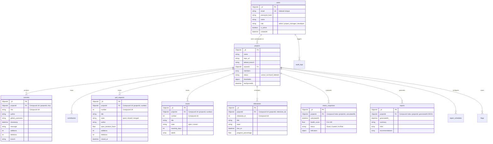

# MongoDB Database Design & Data Architecture

> **AI Software Project Health & Risk Analyzer**  
> **Course / Academic Program:** IT 314 Software Engineering, DA-IICT (DAU)  
> **Database Engine:** MongoDB Atlas (Cloud) / MongoDB Community 7.0+ (Local Docker)  
> **Document Driver:** PyMongo with Synchronous Connection Pool & TLS/SSL Validation  
> **Author & Maintainer:** @Ompatel75 (Om Patel) & Tirth Patel (`@Tirth9978`, Database Architect)  
> **Status:** Production-Ready & Verified across 320+ Automated Tests  

---

## Table of Contents

1. [Architectural Overview & Sub-DAO Pattern](#1-architectural-overview--sub-dao-pattern)
2. [Collections Directory](#2-collections-directory)
3. [Entity-Relationship Diagram](#3-entity-relationship-diagram)
4. [Detailed Collection Schemas & Examples](#4-detailed-collection-schemas--examples)
   - [4.1 `users`](#41-users)
   - [4.2 `projects`](#42-projects)
   - [4.3 `commits`](#43-commits)
   - [4.4 `contributors`](#44-contributors)
   - [4.5 `pull_requests`](#45-pull_requests)
   - [4.6 `issues`](#46-issues)
   - [4.7 `milestones`](#47-milestones)
   - [4.8 `metric_snapshots`](#48-metric_snapshots)
   - [4.9 `reports`](#49-reports)
   - [4.10 `report_schedules`](#410-report_schedules)
   - [4.11 `audit_logs`](#411-audit_logs)
   - [4.12 `flags` & Appeals](#412-flags--appeals)
5. [Index Management & Rationale](#5-index-management--rationale)
6. [Core Query Patterns & Aggregations](#6-core-query-patterns--aggregations)
7. [Data Integrity & Concurrency Controls](#7-data-integrity--concurrency-controls)
8. [Security & Sanitization Guidelines](#8-security--sanitization-guidelines)

---

## 1. Architectural Overview & Sub-DAO Pattern

The storage tier for the AI Software Project Health & Risk Analyzer is implemented using MongoDB. To prevent git merge conflicts and bottlenecks across parallel sprint tasks, the persistence layer is structured into **Sub-DAOs**:

```text
Backend/
├── database.py                 # MongoClient initialization, connection health check, ensure_indexes()
├── persistence.py              # Core DAO: Users, Projects, Commits, Contributors, Org Settings
├── persistence_telemetry.py    # Sub-DAO: Pull Requests, Issues, Milestones, Metric Snapshots
└── persistence_reports.py      # Sub-DAO: AI Status Reports, Delivery Schedules
```

### Key Principles
1. **Tenant Isolation:** Every telemetry, metric, and report document references its parent `projectId: ObjectId` to guarantee complete multi-project data isolation.
2. **Compound Unique Deduplication:** Ingesting commits, contributors, PRs, and issues relies on compound unique indexes (e.g., `(projectId, sha)` and `(projectId, number)`) combined with atomic `$set` upserts. This ensures idempotency under parallel executions and webhook deliveries.
3. **No Unbounded Document Growth:** Avoids MongoDB's 16 MB BSON document limit by storing commits, pull requests, and issues as individual documents rather than embedding thousands of items inside a single project document.
4. **Normalized Telemetry Snapshots:** Aggregated metric scores are periodically stamped into `metric_snapshots` to enable zero-compute historical trend visualization.

---

## 2. Collections Directory

All collections reside within the database defined by `MONGO_DATABASE` (default: `project_health`):

| Collection Name | DAO Source File | Document Identity & Compound Uniqueness | Primary Functional Purpose |
| :--- | :--- | :--- | :--- |
| **`users`** | `Backend/persistence.py` | `_id`, unique index on `email` | User profiles, Bcrypt password hashes, RBAC roles (`admin`, `project_manager`, `developer`), and session state. |
| **`projects`** | `Backend/persistence.py` | `_id`, indexes on `ownerId`, `members.userId` | Project configuration, connected GitHub repository URLs, default branches, risk thresholds, and lifecycle status. |
| **`commits`** | `Backend/persistence.py` | Compound Unique: `(projectId, sha)` | Ingested Git commits, short SHAs, author metadata, lines added/deleted, timestamps, and branch associations. |
| **`contributors`** | `Backend/persistence.py` | Compound Unique: `(projectId, github_username)` | Mapped GitHub contributors, contribution counts, avatar URLs, and profile links. |
| **`pull_requests`** | `Backend/persistence_telemetry.py` | Compound Unique: `(projectId, number)` | PR telemetry, open duration hours, review queue status, merge state, and diff changes. |
| **`issues`** | `Backend/persistence_telemetry.py` | Compound Unique: `(projectId, number)` & `(projectId, github_id)` | Open and closed GitHub issues, labels, inactivity aging days, and stale status. |
| **`milestones`** | `Backend/persistence_telemetry.py` | Compound Unique: `(projectId, milestone_id)` | Sprint milestones, due dates, open vs. closed issue counts, and progress percentages. |
| **`metric_snapshots`** | `Backend/persistence_telemetry.py` | Compound Index: `(projectId, calculatedAt)` | Point-in-time project health scores (0–100), sub-category breakdown, and active risk flag counts. |
| **`reports`** | `Backend/persistence_reports.py` | Compound Index: `(projectId, generatedAt DESC)` | AI-generated status reports, executive summaries, grounded risk explanations, and recommendations. |
| **`report_schedules`** | `Backend/persistence_reports.py` | Compound Index: `(projectId, status)` | Automated report delivery schedules (daily, weekly, monthly) targeting Email and Slack channels. |
| **`audit_logs`** | `Backend/persistence.py` | `_id`, index on `timestamp` | Immutable audit trail for user authentication, project configuration edits, and role modifications. |
| **`flags`** | `Backend/persistence.py` | `_id`, index on `projectId` | Active risk flags (bottlenecks, stale work, workload imbalance) and developer appeal records. |
| **`sprints`** | `Backend/persistence.py` | `_id`, index on `projectId` | Configured agile sprint metadata, start/end dates, and velocity tracking. |
| **`org_settings`** | `Backend/persistence.py` | `_id` | Global organization defaults and system configuration. |
| **`integration_credentials`** | `Backend/persistence.py` | `_id`, compound: `(projectId, provider)` | Securely stored tokens and secrets for external third-party services. |

---

## 3. Entity-Relationship Diagram



---

## 4. Detailed Collection Schemas & Examples

### 4.1 `users`
- **DAO Module:** `Backend/persistence.py`
- **Purpose:** Stores authenticated user identities, password credentials, roles, and profile settings.

| Field Name | BSON Type | Required | Description |
| :--- | :--- | :---: | :--- |
| `_id` | `ObjectId` | Yes | Primary auto-generated document key. |
| `name` | `String` | Yes | Full name of the user (1–100 characters). |
| `email` | `String` | Yes | Unique contact and login email (RFC 5322 formatted). |
| `password_hash`| `String` | Yes | Bcrypt-hashed password string. |
| `role` | `String` | Yes | RBAC role: `admin`, `project_manager`, or `developer`. |
| `is_active` | `Boolean` | Yes | Account lifecycle flag (defaults to `true`). |
| `deactivated_at`| `Date` | No | Timestamp when account was deactivated (or `null`). |
| `notification_preferences` | `Object` | No | Notification preferences (`high_risk_threshold`, `weekly_digest`). |
| `created_at` | `Date` / `String` | Yes | ISO 8601 account creation timestamp. |
| `updated_at` | `Date` / `String` | Yes | ISO 8601 last profile update timestamp. |

#### Real Example Document
```json
{
  "_id": {"$oid": "673f8a19b49e1e3678000001"},
  "name": "Om Patel",
  "email": "ommalvaniya007@gmail.com",
  "password_hash": "$2b$12$eX4mP1eHaShVaLuE.n0TrEa1PaSsw0rdH4sh3dStr1ng",
  "role": "developer",
  "is_active": true,
  "deactivated_at": null,
  "notification_preferences": {
    "high_risk_threshold": true,
    "weekly_digest": false
  },
  "created_at": "2026-11-20T10:15:30.000Z",
  "updated_at": "2026-11-22T18:40:00.000Z"
}
```

---

### 4.2 `projects`
- **DAO Module:** `Backend/persistence.py`
- **Purpose:** Parent entity for all repository data, members, custom risk thresholds, and sync state.

| Field Name | BSON Type | Required | Description |
| :--- | :--- | :---: | :--- |
| `_id` | `ObjectId` | Yes | Primary unique project identifier. |
| `name` | `String` | Yes | Project title (1–200 characters). |
| `description` | `String` | No | Optional scope or architecture description (up to 2000 chars). |
| `repo_url` | `String` | No | GitHub repository URL (`https://github.com/owner/repo`). |
| `default_branch` | `String` | Yes | Primary target git branch (defaults to `main`). |
| `ownerId` | `ObjectId` / `String` | Yes | Reference to `users._id` who created/owns the project. |
| `members` | `Array<Object>` | Yes | List of user bindings: `[{"userId": "...", "role": "owner"}]`. |
| `status` | `String` | Yes | Lifecycle status: `active`, `archived`, or `deleted`. |
| `deletion_status` | `String` | No | Soft-delete state: `none`, `pending`, `completed`. |
| `thresholds` | `Object` | Yes | Custom risk thresholds (`stale_pr_hours`, `stale_issue_days`, etc.). |
| `syncStatus` | `String` | Yes | Current sync state (`idle`, `syncing`, `completed`, `error`). |
| `lastSyncedAt` | `Date` | No | Timestamp of most recent telemetry sync. |
| `createdAt` | `Date` | Yes | Project creation timestamp. |
| `updatedAt` | `Date` | Yes | Last project metadata update timestamp. |

#### Real Example Document
```json
{
  "_id": {"$oid": "673f8a19b49e1e3678000002"},
  "name": "AI Software Project Health & Risk Analyzer",
  "description": "Production monitoring and risk intelligence dashboard.",
  "repo_url": "https://github.com/OpenTirZ/Ai-Software-Project-Health-and-Risk-Analyzer",
  "default_branch": "main",
  "ownerId": {"$oid": "673f8a19b49e1e3678000001"},
  "members": [
    {"userId": "673f8a19b49e1e3678000001", "role": "owner"},
    {"userId": "673f8a19b49e1e3678000003", "role": "member"}
  ],
  "status": "active",
  "deletion_status": "none",
  "thresholds": {
    "stale_pr_hours": 48,
    "stale_issue_days": 14,
    "workload_imbalance_ratio": 3.0,
    "bus_factor_threshold": 0.60
  },
  "syncStatus": "completed",
  "lastSyncedAt": {"$date": "2026-11-22T18:45:00Z"},
  "createdAt": {"$date": "2026-10-15T08:00:00Z"},
  "updatedAt": {"$date": "2026-11-22T18:45:00Z"}
}
```

---

### 4.3 `commits`
- **DAO Module:** `Backend/persistence.py`
- **Compound Index:** `{"projectId": 1, "sha": 1}` [UNIQUE]
- **Purpose:** Stores normalized Git commits ingested via API or real-time Webhook.

| Field Name | BSON Type | Required | Description |
| :--- | :--- | :---: | :--- |
| `_id` | `ObjectId` | Yes | Primary key. |
| `projectId` | `ObjectId` | Yes | Reference to `projects._id`. |
| `sha` | `String` | Yes | Full 40-character Git commit hash. |
| `short_sha` | `String` | Yes | 7-character abbreviated commit hash. |
| `author` | `String` | Yes | Name of the commit author. |
| `github_username` | `String` | No | Resolved GitHub username (if available). |
| `timestamp` | `Date` / `String` | Yes | ISO 8601 commit timestamp. |
| `message` | `String` | Yes | Full Git commit message. |
| `additions` | `Integer` | Yes | Number of lines added. |
| `deletions` | `Integer` | Yes | Number of lines deleted. |
| `total_changes` | `Integer` | Yes | Sum of additions and deletions. |
| `repository` | `String` | No | Repository slug (`owner/repo`). |
| `branch` | `String` | No | Branch where commit was ingested (`main`, etc.). |
| `updated_at` | `Date` | Yes | Timestamp of record upsert. |

#### Real Example Document
```json
{
  "_id": {"$oid": "673f8a19b49e1e3678000004"},
  "projectId": {"$oid": "673f8a19b49e1e3678000002"},
  "sha": "8edec16a75f1b2c3d4e5f6a7b8c9d0e1f2a3b4c5",
  "short_sha": "8edec16",
  "author": "Om Patel",
  "github_username": "Ompatel75",
  "timestamp": "2026-11-22T18:59:00Z",
  "message": "test(webhooks): add test_webhooks.py covering signatures, events and edge cases",
  "additions": 586,
  "deletions": 0,
  "total_changes": 586,
  "repository": "OpenTirZ/Ai-Software-Project-Health-and-Risk-Analyzer",
  "branch": "main",
  "updated_at": {"$date": "2026-11-22T18:59:33Z"}
}
```

---

### 4.4 `contributors`
- **DAO Module:** `Backend/persistence.py`
- **Compound Index:** `{"projectId": 1, "github_username": 1}` [UNIQUE]
- **Purpose:** Stores aggregated project contributor statistics and profile references.

#### Real Example Document
```json
{
  "_id": {"$oid": "673f8a19b49e1e3678000005"},
  "projectId": {"$oid": "673f8a19b49e1e3678000002"},
  "github_username": "Ompatel75",
  "avatar_url": "https://avatars.githubusercontent.com/u/12345678?v=4",
  "profile_url": "https://github.com/Ompatel75",
  "contributions": 42,
  "last_synced_at": {"$date": "2026-11-22T18:45:00Z"}
}
```

---

### 4.5 `pull_requests`
- **DAO Module:** `Backend/persistence_telemetry.py`
- **Compound Index:** `{"projectId": 1, "number": 1}` [UNIQUE]
- **Purpose:** Tracks PR lifecycle states, review queue latency, and code changes.

| Field Name | BSON Type | Required | Description |
| :--- | :--- | :---: | :--- |
| `_id` | `ObjectId` | Yes | Primary key. |
| `projectId` | `ObjectId` | Yes | Reference to `projects._id`. |
| `number` | `Integer` | Yes | Pull Request number on GitHub. |
| `title` | `String` | Yes | Title of the pull request. |
| `state` | `String` | Yes | Normalized state: `open`, `closed`, or `merged`. |
| `author` | `String` | Yes | Creator username. |
| `open_duration_hours`| `Double` | Yes | Hours PR has remained open (used for bottleneck detection). |
| `merged` | `Boolean` | Yes | True if PR was merged into base branch. |
| `draft` | `Boolean` | Yes | True if PR is currently marked as draft. |
| `requested_reviewers`| `Array<String>` | Yes | List of requested reviewer usernames. |
| `additions` | `Integer` | Yes | Lines of code added. |
| `deletions` | `Integer` | Yes | Lines of code deleted. |
| `created_at` | `Date` / `String` | Yes | PR creation timestamp. |
| `closed_at` | `Date` / `String` | No | PR closure timestamp (or `null`). |
| `last_synced_at` | `Date` | Yes | Last synchronization timestamp. |

#### Real Example Document
```json
{
  "_id": {"$oid": "673f8a19b49e1e3678000006"},
  "projectId": {"$oid": "673f8a19b49e1e3678000002"},
  "number": 141,
  "title": "Merge pull request #141 from OpenTirZ/varshil/sp4-01",
  "state": "merged",
  "author": "svarshil56",
  "github_username": "svarshil56",
  "merged": true,
  "draft": false,
  "open_duration_hours": 3.5,
  "requested_reviewers": ["Ompatel75", "Tirth9978"],
  "reviews": [],
  "additions": 145,
  "deletions": 12,
  "html_url": "https://github.com/OpenTirZ/Ai-Software-Project-Health-and-Risk-Analyzer/pull/141",
  "created_at": "2026-11-22T14:00:00Z",
  "updated_at": "2026-11-22T17:30:00Z",
  "closed_at": "2026-11-22T17:30:00Z",
  "merged_at": "2026-11-22T17:30:00Z",
  "last_synced_at": {"$date": "2026-11-22T18:45:00Z"}
}
```

---

### 4.6 `issues`
- **DAO Module:** `Backend/persistence_telemetry.py`
- **Compound Indexes:** `{"projectId": 1, "number": 1}` [UNIQUE] & `{"projectId": 1, "github_id": 1}` [UNIQUE partial]
- **Purpose:** Ingests issues, filtering out pull requests, and calculates inactivity aging days to identify stale blockers.

#### Real Example Document
```json
{
  "_id": {"$oid": "673f8a19b49e1e3678000007"},
  "projectId": {"$oid": "673f8a19b49e1e3678000002"},
  "number": 162,
  "github_id": 987654321,
  "title": "Sprint 1–4 Details Documentation",
  "state": "open",
  "author": "Ompatel75",
  "github_username": "Ompatel75",
  "assignees": ["Ompatel75"],
  "labels": ["documentation", "sprint-4"],
  "comments_count": 3,
  "inactivity_days": 1,
  "created_at": "2026-11-23T10:00:00Z",
  "updated_at": "2026-11-24T02:00:00Z",
  "closed_at": null,
  "html_url": "https://github.com/OpenTirZ/Ai-Software-Project-Health-and-Risk-Analyzer/issues/162",
  "last_synced_at": {"$date": "2026-11-24T03:00:00Z"}
}
```

---

### 4.7 `milestones`
- **DAO Module:** `Backend/persistence_telemetry.py`
- **Compound Index:** `{"projectId": 1, "milestone_id": 1}` [UNIQUE]
- **Purpose:** Tracks sprint milestone deadlines, completion rates, and schedule risk indicators.

#### Real Example Document
```json
{
  "_id": {"$oid": "673f8a19b49e1e3678000008"},
  "projectId": {"$oid": "673f8a19b49e1e3678000002"},
  "milestone_id": 4,
  "number": 4,
  "title": "Sprint 4: Hardening, Webhooks & Release",
  "description": "Finalize project lifecycle, webhook listeners, deployment & documentation.",
  "state": "open",
  "due_on": "2026-11-24T23:59:59Z",
  "open_issues": 3,
  "closed_issues": 19,
  "progress_percentage": 86.36,
  "created_at": "2026-11-21T08:00:00Z",
  "updated_at": "2026-11-24T03:00:00Z",
  "last_synced_at": {"$date": "2026-11-24T03:00:00Z"}
}
```

---

### 4.8 `metric_snapshots`
- **DAO Module:** `Backend/persistence_telemetry.py`
- **Compound Index:** `{"projectId": 1, "calculatedAt": 1}`
- **Purpose:** Historical point-in-time calculation snapshots powering dashboard graphs and trend analysis.

#### Real Example Document
```json
{
  "_id": {"$oid": "673f8a19b49e1e3678000009"},
  "projectId": {"$oid": "673f8a19b49e1e3678000002"},
  "calculatedAt": {"$date": "2026-11-24T03:00:00Z"},
  "health_score": 88.5,
  "status": "Good",
  "flags_count": 1,
  "weights_used": {
    "bottlenecks": 0.35,
    "workload": 0.25,
    "stale_issues": 0.20,
    "schedule_risk": 0.20
  },
  "indicators": {
    "bottlenecks": {
      "score": 92.0,
      "stale_prs_count": 0,
      "avg_pr_age_hours": 12.4
    },
    "workload": {
      "score": 80.0,
      "bus_factor_risk": false,
      "top_contributor_ratio": 0.38
    },
    "stale_issues": {
      "score": 90.0,
      "stale_issues_count": 1
    },
    "schedule_risk": {
      "score": 88.0,
      "milestone_slippage_days": 0
    }
  }
}
```

---

### 4.9 `reports`
- **DAO Module:** `Backend/persistence_reports.py`
- **Compound Index:** `{"projectId": 1, "generatedAt": -1}` (newest-first read directly from index)
- **Purpose:** Validated status reports generated by the LangGraph V2 AI pipeline.

#### Real Example Document
```json
{
  "_id": {"$oid": "673f8a19b49e1e3678000010"},
  "projectId": {"$oid": "673f8a19b49e1e3678000002"},
  "generatedAt": {"$date": "2026-11-24T03:00:00Z"},
  "pipelineVersion": "LangGraph-V2",
  "summary": "Project health remains stable at 88.5/100 (Good). Review queues are actively cleared and Sprint 4 milestone progress is at 86%.",
  "risks": [
    {
      "severity": "LOW",
      "category": "stale_issues",
      "description": "Issue #162 has been open without code activity for 24 hours.",
      "metricRef": "stale_issues.count"
    }
  ],
  "recommendations": [
    {
      "priority": "LOW",
      "action": "Complete technical documentation before final sprint freeze.",
      "advisory": true
    }
  ],
  "metricsSnapshot": {
    "health_score": 88.5,
    "status": "Good"
  },
  "rawPromptTokens": 1420,
  "createdAt": {"$date": "2026-11-24T03:00:02Z"}
}
```

---

### 4.10 `report_schedules`
- **DAO Module:** `Backend/persistence_reports.py`
- **Compound Index:** `{"projectId": 1, "status": 1}`
- **Purpose:** Recurring report automation settings (daily, weekly, monthly).

#### Real Example Document
```json
{
  "_id": {"$oid": "673f8a19b49e1e3678000011"},
  "projectId": {"$oid": "673f8a19b49e1e3678000002"},
  "frequency": "weekly",
  "destinations": ["email", "slack"],
  "status": "active",
  "lastRun": {"$date": "2026-11-22T08:00:00Z"},
  "nextRunAt": {"$date": "2026-11-29T08:00:00Z"},
  "createdAt": {"$date": "2026-11-15T10:00:00Z"},
  "updatedAt": {"$date": "2026-11-22T08:00:00Z"}
}
```

---

### 4.11 `audit_logs`
- **DAO Module:** `Backend/persistence.py`
- **Index:** `{"timestamp": -1}`
- **Purpose:** Immutable compliance record of access, security, and project lifecycle events (NFR-10).

#### Real Example Document
```json
{
  "_id": {"$oid": "673f8a19b49e1e3678000012"},
  "timestamp": {"$date": "2026-11-22T18:45:00Z"},
  "userId": "673f8a19b49e1e3678000001",
  "action": "WEBHOOK_EVENT_INGESTED",
  "resourceType": "webhook",
  "resourceId": "delivery-push-8edec16",
  "details": "Synchronized 2 push commits for project 673f8a19b49e1e3678000002",
  "ipAddress": "127.0.0.1"
}
```

---

### 4.12 `flags` & Appeals
- **DAO Module:** `Backend/persistence.py`
- **Index:** `{"projectId": 1}`
- **Purpose:** Stores triggered risk indicators and supports developer appeals to prevent inaccurate algorithmic conclusions.

#### Real Example Document
```json
{
  "_id": {"$oid": "673f8a19b49e1e3678000013"},
  "projectId": {"$oid": "673f8a19b49e1e3678000002"},
  "type": "WORKLOAD_CONCENTRATION",
  "severity": "MEDIUM",
  "title": "High commit concentration on single contributor",
  "description": "Contributor Shah Varshil accounts for 42% of recent commits.",
  "status": "appealed",
  "appeal": {
    "appealedBy": "673f8a19b49e1e3678000003",
    "reason": "Concentration reflects architectural setup sprint, not long-term imbalance.",
    "status": "approved",
    "reviewedBy": "673f8a19b49e1e3678000001",
    "reviewedAt": {"$date": "2026-11-12T14:00:00Z"}
  },
  "createdAt": {"$date": "2026-11-10T12:00:00Z"}
}
```

---

## 5. Index Management & Rationale

Index management is declared programmatically in `Backend/database.py` via `ensure_indexes()`, which is executed during the FastAPI startup lifespan:

```python
def ensure_indexes():
    # 1. Deduplication on contributors per project
    contributors_collection.create_index([("projectId", 1), ("github_username", 1)], unique=True, background=True)
    
    # 2. Compound unique indexing on commits
    commits_collection.create_index([("projectId", 1), ("sha", 1)], unique=True, background=True)
    
    # 3. Compound unique indexing on PRs and issues
    pull_requests_collection.create_index([("projectId", 1), ("number", 1)], unique=True, background=True)
    issues_collection.create_index([("projectId", 1), ("number", 1)], unique=True, background=True)
    milestones_collection.create_index([("projectId", 1), ("milestone_id", 1)], unique=True, background=True)
    
    # 4. Partial index for GitHub issues with legacy data resilience
    issues_collection.create_index(
        [("projectId", 1), ("github_id", 1)],
        unique=True,
        background=True,
        partialFilterExpression={"github_id": {"$exists": True}}
    )
    
    # 5. Fast history sorting and lookup
    reports_collection.create_index([("projectId", 1), ("generatedAt", -1)], background=True)
    report_schedules_collection.create_index([("projectId", 1), ("status", 1)], background=True)
    metric_snapshots_collection.create_index([("projectId", 1), ("calculatedAt", 1)], background=True)
    projects_collection.create_index([("ownerId", 1)], background=True)
    projects_collection.create_index([("members.userId", 1)], background=True)
```

### Why Background Creation (`background=True`)?
Building indexes in the background prevents blocking concurrent read/write operations during cluster initialization or container restart on production instances.

---

## 6. Core Query Patterns & Aggregations

### Pattern 1: Idempotent Atomic Commit Upsert
Avoids duplicate writes when webhook events and manual sync occur concurrently:
```python
filter_query = {"projectId": to_object_id(project_id), "sha": commit_data["sha"]}
update_doc = {"$set": {**commit_data, "updated_at": datetime.now(timezone.utc)}}
commits_collection.update_one(filter_query, update_doc, upsert=True)
```

### Pattern 2: Project Health Aggregation Pipeline
Retrieves recent commit volume, active PRs, and open issues in a single database aggregation:
```python
pipeline = [
    {"$match": {"projectId": ObjectId(project_id)}},
    {"$group": {
        "_id": "$author",
        "commit_count": {"$sum": 1},
        "total_additions": {"$sum": "$additions"},
        "total_deletions": {"$sum": "$deletions"}
    }},
    {"$sort": {"commit_count": -1}}
]
contributor_stats = list(commits_collection.aggregate(pipeline))
```

### Pattern 3: Newest-First Paginated Report History
Leverages the compound index `(projectId: 1, generatedAt: -1)` for zero-memory sort operations:
```python
cursor = reports_collection.find({"projectId": ObjectId(project_id)}).sort("generatedAt", -1).skip(offset).limit(limit)
```

---

## 7. Data Integrity & Concurrency Controls

1. **Compound Uniqueness:** All ingestions use compound keys `(projectId, natural_id)` preventing cross-project key collisions.
2. **Soft-Delete Project Reconciliation:** When a project status changes to `deleted` or `archived`, writes to telemetry collections are rejected using `_check_project_writable(project_id)` in `Backend/persistence.py`.
3. **Idempotency Queue:** In `Backend/externalservies/webhook_service.py`, deliveries from GitHub are tracked in an in-memory bounded LRU cache (`_processed_deliveries`) to discard duplicate delivery deliveries before triggering DB queries.

---

## 8. Security & Sanitization Guidelines

- **No Secrets in Database Documents:** GitHub tokens, SMTP passwords, and Slack webhook URLs are never stored in plain text.
- **Log Masking:** A custom logging filter (`_SecretMaskingFilter` in `Backend/main.py`) dynamically scrubs tokens, secrets, and Mongo connection strings from log outputs.
- **TLS/SSL Encryption:** When running against MongoDB Atlas (`mongodb+srv://`), TLS encryption is strictly enforced using `certifi.where()`.
