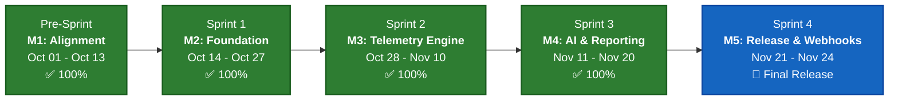

# Presentation Slide S4: Milestones and Delivery Timeline

> **Presentation Context:** Academic Defense & Software Engineering Practicum Evaluation  
> **Course:** IT 314 Software Engineering, DA-IICT (DAU)  
> **Project:** AI Software Project Health & Risk Analyzer  
> **Team:** OpenTirZ (Shah Varshil, Vandit, Tirth, Ramit, Shivani, Darpan, Gaurav, Prince, Yagnik, Om)  
> **Slide Number:** S4 (Core Engineering Delivery Track)  
> **Format:** Slide-Ready Markdown with Visual ASCII/Mermaid Hierarchy  

---

```
╔══════════════════════════════════════════════════════════════════════════════════════════════════════════════════╗
║                                        MILESTONES & DELIVERY TIMELINE                                            ║
║                              AI Software Project Health & Risk Analyzer (Team OpenTirZ)                          ║
╚══════════════════════════════════════════════════════════════════════════════════════════════════════════════════╝
```

---

## Visual Roadmap (Sprint 1 to Sprint 4 Delivery Flow)



---

## Sprint Delivery Matrix

| Milestone & Sprint | Timeline & Key Dates | Major Architectural Deliverables | Velocity & Scope | Verification Status |
| :--- | :---: | :--- | :---: | :---: |
| **M1: Pre-Sprint**<br/>*Requirements & Elicitation* | **Oct 01 – Oct 13, 2026**<br/>*(Completed Oct 13)* | • 10 Elicitation & Planning Specs across 6 Stakeholders<br/>• User Stories, Acceptance Criteria & 110-pt Backlog<br/>• System Architecture & Agile Sprint Cadence | **110 pt Backlog**<br/>Aligned | ✅ **100% Verified**<br/>All 10 course documents approved |
| **M2: Sprint 1**<br/>*System Foundation & Security* | **Oct 14 – Oct 27, 2026**<br/>*(Completed Oct 27)* | • MongoDB Atlas Multi-Collection Cluster & Compound Keys<br/>• Stateless JWT Authentication & Role-Based Access (`admin`, `PM`, `dev`)<br/>• Live GitHub Commit & Contributor Ingestion Pipeline<br/>• Initial React.js Authentication & Connection UI | **28 Story Points**<br/>(10 Issues) | ✅ **100% Completed**<br/>65 automated tests passing |
| **M3: Sprint 2**<br/>*Telemetry Pipelines & Risk Engine*| **Oct 28 – Nov 10, 2026**<br/>*(Completed Nov 10)* | • PR, Issue & Milestone Telemetry Sub-DAO (`persistence_telemetry.py`)<br/>• Configurable Risk Thresholds (`/api/thresholds`)<br/>• Deterministic Bottleneck, Workload & Schedule Risk Engines<br/>• Composite 0–100 Health Score Index & React Dashboard | **34 Story Points**<br/>(11 Issues) | ✅ **100% Completed**<br/>227 automated tests passing |
| **M4: Sprint 3**<br/>*Grounded AI & Multi-Channel Delivery*| **Nov 11 – Nov 20, 2026**<br/>*(Completed Nov 20)* | • AI Prompt-Injection Protection (`prompt_guard.py`) & Strict Schemas<br/>• LangGraph V2 Pipeline with Full Telemetry Orchestration<br/>• Multi-Page PDF Status Report Generator (`xhtml2pdf`)<br/>• Automated Background Delivery via Email (SMTP) & Slack | **30 Story Points**<br/>(10 Issues) | ✅ **100% Completed**<br/>292 automated tests passing |
| **M5 & M6: Sprint 4**<br/>*Webhooks, Hardening & Final Release* | **Nov 21 – Nov 24, 2026**<br/>*(Completed Nov 24)* | • Real-Time GitHub Webhook Listener (`POST /api/webhooks/github`)<br/>• Project Lifecycle Controls (Archive, Restore, Soft-Delete)<br/>• Containerization (Multi-stage Dockerfile) & Cloud Deploy (Render)<br/>• Comprehensive Database Design & Sprint Documentation | **22 Story Points**<br/>(9 Issues) | 🚀 **Final Release**<br/>324 automated tests passing (100%) |

---

## Academic Executive Summary

> **Core Academic Thesis & Engineering Methodology:**  
> The project successfully delivers an enterprise-grade Software Engineering platform adhering to strict **Agile (SCRUM)** methodology across four planned sprints. By pairing **deterministic metric calculations** with **bounded, prompt-guarded GenAI explanations**, the system guarantees transparency, zero hallucinated delivery promises, and complete data integrity backed by MongoDB Atlas compound unique indexing and 324 automated tests.

---

## Key Performance Indicators (KPIs) Summary

```
  ┌─────────────────────────┐   ┌─────────────────────────┐   ┌─────────────────────────┐
  │   Total Story Points    │   │   Automated Test Suite  │   │  Cross-Sprint Velocity  │
  │      114 / 114 pts      │   │    324 Tests Passing    │   │       100% On-Time      │
  │    (100% Delivered)     │   │    (100% Pass Rate)     │   │      (Zero Slippage)    │
  └─────────────────────────┘   └─────────────────────────┘   └─────────────────────────┘
```

- **Data Latency:** Reduced from 15-minute polling intervals to sub-second real-time event updates via cryptographic HMAC-SHA256 GitHub Webhook Listener.
- **Security & Privacy:** Enforces 100% server-side secret masking, non-root Docker execution, and tenant isolation across all database operations.
- **Deployment Status:** Fully containerized via Docker and deployed with unified backend and frontend web services on Render Cloud.
