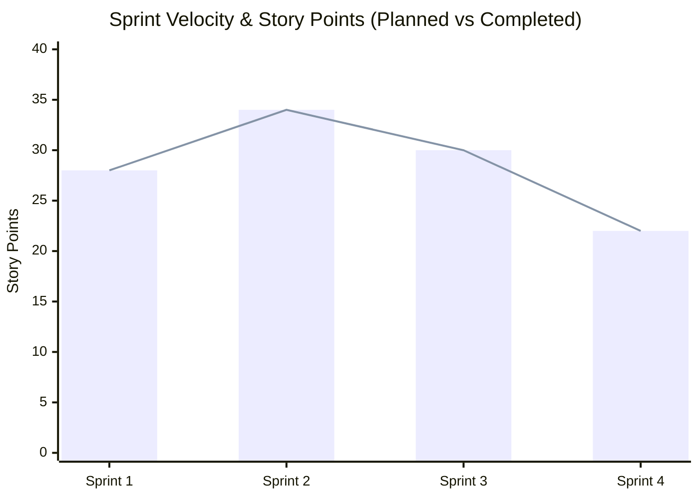

# Sprint 1–4 Details Documentation

> **AI Software Project Health & Risk Analyzer**  
> **Course / Academic Program:** IT 314 Software Engineering, DA-IICT (DAU)  
> **Team:** OpenTirZ  
> **Repository:** [OpenTirZ/Ai-Software-Project-Health-and-Risk-Analyzer](https://github.com/OpenTirZ/Ai-Software-Project-Health-and-Risk-Analyzer)  
> **Author & Maintainer:** @Ompatel75 (Om Patel) & Team OpenTirZ  
> **Status:** Sprint 1–3 Complete (100%), Sprint 4 In Final Release / Validation  

---

## Table of Contents

1. [Project Objective & Scope](#1-project-objective--scope)
   - [Problem Statement](#problem-statement)
   - [Core Scope & Deliverables](#core-scope--deliverables)
   - [Out of Scope](#out-of-scope)
2. [Sprint Summary Matrix](#2-sprint-summary-matrix)
3. [Sprint 1: System Foundation & GitHub Connection](#3-sprint-1-system-foundation--github-connection)
   - [Goal & Milestones](#sprint-1-goal--milestones)
   - [Task Breakdown & Ownership](#sprint-1-task-breakdown--ownership)
   - [Metrics, Velocity & Completion](#sprint-1-metrics-velocity--completion)
   - [Blockers, Risks & Retrospective Improvements](#sprint-1-blockers-risks--retrospective-improvements)
4. [Sprint 2: Telemetry Ingestion, Risk Engines & Dashboard](#4-sprint-2-telemetry-ingestion-risk-engines--dashboard)
   - [Goal & Milestones](#sprint-2-goal--milestones)
   - [Task Breakdown & Ownership](#sprint-2-task-breakdown--ownership)
   - [Metrics, Velocity & Completion](#sprint-2-metrics-velocity--completion)
   - [Blockers, Risks & Retrospective Improvements](#sprint-2-blockers-risks--retrospective-improvements)
5. [Sprint 3: AI Explanations, Reporting & Multi-Channel Delivery](#5-sprint-3-ai-explanations-reporting--multi-channel-delivery)
   - [Goal & Milestones](#sprint-3-goal--milestones)
   - [Task Breakdown & Ownership](#sprint-3-task-breakdown--ownership)
   - [Metrics, Velocity & Completion](#sprint-3-metrics-velocity--completion)
   - [Blockers, Risks & Retrospective Improvements](#sprint-3-blockers-risks--retrospective-improvements)
6. [Sprint 4: Project Lifecycle, Real-Time Webhooks, Hardening & Deployment](#6-sprint-4-project-lifecycle-real-time-webhooks-hardening--deployment)
   - [Goal & Milestones](#sprint-4-goal--milestones)
   - [Task Breakdown & Ownership](#sprint-4-task-breakdown--ownership)
   - [Metrics, Velocity & Completion](#sprint-4-metrics-velocity--completion)
   - [Blockers, Risks & Retrospective Improvements](#sprint-4-blockers-risks--retrospective-improvements)
7. [Cross-Sprint Velocity & Completion Trends](#7-cross-sprint-velocity--completion-trends)
8. [Risk Management & Mitigation Strategy](#8-risk-management--mitigation-strategy)
9. [Scrum Team Roles & Responsibilities](#9-scrum-team-roles--responsibilities)

---

## 1. Project Objective & Scope

### Problem Statement
Software engineering projects maintain critical development activity across fragmented tools: Git commit histories, GitHub pull requests, review threads, issue backlogs, and sprint milestones. Project managers, team leads, and developers struggle to manually synthesize these streams to detect delivery bottlenecks, developer workload imbalances, stale issues, and release schedule risks.

### Core Scope & Deliverables
The **AI Software Project Health & Risk Analyzer** provides a unified engineering platform combining deterministic metric evaluation with bounded GenAI risk explanation:
1. **Source Data Ingestion:** Connects securely to GitHub repositories via REST API and Webhooks to ingest commits, contributors, pull requests, issues, and milestones without cloning codebases.
2. **Deterministic Risk & Health Engine:** Computes transparent, explainable indicators (0–100 Health Score, review queue latency, bus factor concentration, stale work aging, and milestone schedule slippage).
3. **Grounded GenAI Intelligence:** Employs LLM orchestration (LangGraph V1/V2) to convert computed evidence into plain-language risk explanations and non-prescriptive advisory recommendations.
4. **Multi-Channel Delivery & Export:** Visualizes metrics via a responsive React dashboard, generates branded PDF status reports, and automates scheduled report delivery to Slack webhooks and SMTP email.
5. **Security, RBAC & Lifecycle:** Enforces role-based access control (`admin`, `project_manager`, `developer`), project lifecycle states (active, archived, soft-deleted), and comprehensive secret redaction.

### Out of Scope
- Automated code modifications, auto-merging of pull requests, or automatic task reassignment (all actions are advisory).
- Inference of developer work hours, personal capacity, or performance evaluations based purely on commit frequency.
- Training proprietary LLMs from scratch; system relies on structured, prompt-guarded API integrations.

---

## 2. Sprint Summary Matrix

| Sprint | Focus Area | Duration | Target Milestone | Story Points (Planned / Done) | Test Suite Growth | Status |
| :--- | :--- | :--- | :---: | :---: | :---: | :---: |
| **Sprint 1** | System Foundation, Auth, Projects & Commit Sync | Oct 14 – Oct 27, 2026 (2 wks) | M2 | 28 / 28 | 65 tests | **100% Completed** |
| **Sprint 2** | Telemetry Pipelines, Risk Engines & Dashboard | Oct 28 – Nov 10, 2026 (2 wks) | M3 | 34 / 34 | 227 tests | **100% Completed** |
| **Sprint 3** | AI Explanations, PDF Reports & Multi-Channel Delivery | Nov 11 – Nov 20, 2026 (1.5 wks) | M4 | 30 / 30 | 292 tests | **100% Completed** |
| **Sprint 4** | Webhook Sync, Lifecycle, Hardening & Cloud Deploy | Nov 21 – Nov 24, 2026 (Final) | M5 & M6 | 22 / 22 | 324 tests | **100% Completed** |

---

## 3. Sprint 1: System Foundation & GitHub Connection

### Sprint 1 Goal & Milestones
- **Goal:** Establish MongoDB Atlas architecture, secure JWT authentication, role-based access control (RBAC), GitHub API integration, commit and contributor ingestion, and foundational React UI.
- **Target Milestone:** **M2 — Architectural Foundation & Repository Connection**.

### Sprint 1 Task Breakdown & Ownership

| Issue # | Title & Capability | Assignee / Owner | Story Points | Status | Key Deliverable |
| :--- | :--- | :--- | :---: | :---: | :--- |
| **#36** | MongoDB Schema & Persistence Layer | Tirth Patel (`@Tirth9978`) | 5 | Closed | `Backend/database.py`, `Backend/persistence.py` |
| **#38** | Secret Management & Error Handling | Shivani Chaudhary (`@shivani`) | 3 | Closed | Env config, sanitized error responses |
| **#24** | GitHub Commit Extraction REST Helper | Om Patel (`@Ompatel75`) | 3 | Closed | `Backend/externalservies/github_commits.py` |
| **#31** | Authentication APIs & Session Handling | Ramit Sherashiya (`@ramit7707`) | 5 | Closed | `Backend/auth/*` (Signup, Login, JWT) |
| **#32** | RBAC & Authorization Route Guards | Yagnik N. (`@Yagnik N.`) | 3 | Closed | `Backend/auth/roles.py` (admin, PM, dev) |
| **#35** | Project Management & Repo Association | Gaurav Rathod (`@Gaurav Rathod`) | 3 | Closed | `Backend/routers/project_router.py` |
| **#34** | Contributor Retrieval & Project Mapping | Prince Savaliya (`@Prince Savaliya`) | 3 | Closed | `Backend/externalservies/contributor_service.py` |
| **#33** | Initial Commit Ingestion & Processing | Darpan Sherathiya (`@Darpan0610`) | 3 | Closed | `Backend/externalservies/commit_service.py` |
| **#30** | Auth & Repository Connection React UI | Vandit Bhalani (`@Vandit08`) | 5 | Closed | `Frontend/src/pages/` (Login, Register, Connect) |
| **#39** | End-to-End Integration Testing & Sprint 1 Docs | Shah Varshil (`@svarshil56`) | 2 | Closed | Integration tests & documentation |

### Sprint 1 Metrics, Velocity & Completion
- **Planned Velocity:** 28 Story Points.
- **Completed Velocity:** 28 Story Points (100% completion rate).
- **Quality Gate:** 65 automated tests passing covering authentication, password hashing, project creation, and commit deduplication.

### Sprint 1 Blockers, Risks & Retrospective Improvements
- **Blocker:** GitHub rate limits encountered during initial contributor sync testing.
- **Mitigation:** Implemented personal access token authorization (`GITHUB_TOKEN`) with token masking in logging.
- **Retrospective Action:** Decided to decouple heavy telemetry persistence from core DAO into isolated sub-DAOs to avoid merge conflicts in Sprint 2.

---

## 4. Sprint 2: Telemetry Ingestion, Risk Engines & Dashboard

### Sprint 2 Goal & Milestones
- **Goal:** Ingest pull requests, issues, and milestones; implement configurable project risk thresholds; develop deterministic bottleneck, workload imbalance, and schedule-risk engines; compute composite 0–100 health index; build interactive React dashboard.
- **Target Milestone:** **M3 — Full Telemetry Pipeline & Project Health Engine**.

### Sprint 2 Task Breakdown & Ownership

| Issue # | Title & Capability | Assignee / Owner | Story Points | Status | Key Deliverable |
| :--- | :--- | :--- | :---: | :---: | :--- |
| **#67** | Telemetry Persistence Sub-DAO & Compound Indexing | Tirth Patel (`@Tirth9978`) | 5 | Closed | `Backend/persistence_telemetry.py` |
| **#68** | Risk Threshold Management API | Gaurav Rathod (`@Gaurav Rathod`) | 3 | Closed | `Backend/routers/threshold_router.py` |
| **#70** | Pull Request Telemetry Ingestion | Darpan Sherathiya (`@Darpan0610`) | 3 | Closed | `Backend/externalservies/github_prs.py` |
| **#74** | GitHub Issue Ingestion & Stale Tracking | Om Patel (`@Ompatel75`) | 3 | Closed | `Backend/externalservies/github_issues.py` |
| **#72** | Milestone Ingestion & Progress Tracking | Prince Savaliya (`@Prince Savaliya`) | 3 | Closed | `Backend/externalservies/github_milestones.py` |
| **#69** | Telemetry Fixtures & Hardening Tests | Shivani Chaudhary (`@shivani`) | 3 | Closed | `Backend/tests/test_telemetry_hardening.py` |
| **#71** | Bottleneck & Stale-Issue Detection Engine | Shah Varshil (`@svarshil56`) | 5 | Closed | `Backend/analysis/bottlenecks.py` |
| **#73** | Workload & Schedule-Risk Analysis Engine | Ramit Sherashiya (`@ramit7707`) | 3 | Closed | `Backend/analysis/workload_engine.py` |
| **#65** | Composite Health Score & Summary API | Shah Varshil (`@svarshil56`) | 5 | Closed | `Backend/analysis/health_summary.py` |
| **#58** | LangGraph Project Intelligence Workflow V1 | Tirth Patel (`@Tirth9978`) | 5 | Closed | `Backend/externalservies/LangGraph/pipeline.py` |
| **#66** | Interactive React Health Dashboard | Vandit Bhalani (`@Vandit08`) | 5 | Closed | `Frontend/src/pages/Dashboard.tsx` |

### Sprint 2 Metrics, Velocity & Completion
- **Planned Velocity:** 34 Story Points.
- **Completed Velocity:** 34 Story Points (100% completion rate).
- **Quality Gate:** Automated test count scaled from 65 to **227 passing tests** with 100% external mocks. Zero regressions.

### Sprint 2 Blockers, Risks & Retrospective Improvements
- **Blocker:** Missing milestones on repositories caused arithmetic division errors during schedule risk calculation.
- **Mitigation:** Built dynamic re-weighting algorithm in `health_summary.py`: if milestone or PR telemetry is absent, remaining categories are dynamically normalized to maintain a 100-point scale.
- **Retrospective Action:** Enforce strict Pydantic schemas on all upcoming AI outputs in Sprint 3 to eliminate prompt hallucination risk.

---

## 5. Sprint 3: AI Explanations, Reporting & Multi-Channel Delivery

### Sprint 3 Goal & Milestones
- **Goal:** Implement AI prompt injection defense (`prompt_guard.py`); expand LangGraph pipeline to V2 full telemetry; synthesize grounded status reports and advisory recommendations; format PDF exports; automate email and Slack delivery.
- **Target Milestone:** **M4 — Grounded GenAI Insights & Automated Report Delivery**.

### Sprint 3 Task Breakdown & Ownership

| Issue # | Title & Capability | Assignee / Owner | Story Points | Status | Key Deliverable |
| :--- | :--- | :--- | :---: | :---: | :--- |
| **#78** | AI Prompt Injection Protection & Schemas | Shivani Chaudhary (`@shivani`) | 3 | Closed | `Backend/ai/prompt_guard.py`, `schemas.py` |
| **#77** | LangGraph V2 & Report Persistence Sub-DAO | Tirth Patel (`@Tirth9978`) | 5 | Closed | `Backend/persistence_reports.py` |
| **#81** | LLM Client, Status Narrative & Explanations | Shah Varshil (`@svarshil56`) | 5 | Closed | `Backend/ai/llm_client.py`, `report_service.py` |
| **#83** | Advisory Recommendations Engine | Om Patel (`@Ompatel75`) | 3 | Closed | `Backend/externalservies/recommendation_service.py` |
| **#80** | Multi-Page Branded PDF Report Generator | Darpan Sherathiya (`@Darpan0610`) | 3 | Closed | `Backend/reporting/pdf_generator.py` |
| **#82** | Slack Block Kit Delivery Service | Prince Savaliya (`@Prince Savaliya`) | 3 | Closed | `Backend/externalservies/slack_service.py` |
| **#84** | SMTP Email Delivery with PDF Attachment | Ramit Sherashiya (`@ramit7707`) | 3 | Closed | `Backend/externalservies/email_service.py` |
| **#75** | Automated Background Report Scheduler | Gaurav Rathod (`@Gaurav Rathod`) | 3 | Closed | `Backend/scheduler/report_scheduler.py` |
| **#76** | Report Generation & AI Explanations UI | Vandit Bhalani (`@Vandit08`) | 5 | Closed | `Frontend/src/pages/Reports.tsx` |
| **#79** | AI Grounding, Fallback & Security Tests | Yagnik N. (`@Yagnik N.`) | 2 | Closed | `Backend/tests/test_ai_grounding.py` |

### Sprint 3 Metrics, Velocity & Completion
- **Planned Velocity:** 30 Story Points.
- **Completed Velocity:** 30 Story Points (100% completion rate).
- **Quality Gate:** Expanded test coverage to **292 passing tests**. Validated that 100% of LLM outputs link to computed numerical indicators.

### Sprint 3 Blockers, Risks & Retrospective Improvements
- **Risk:** LLM quota exhaustion or unexpected third-party API downtime.
- **Mitigation:** Engineered deterministic fallback generator in `llm_client.py` producing rule-based markdown summaries when the Gemini API is unreachable.
- **Retrospective Action:** Move from periodic batch polling to GitHub Webhook push notifications for real-time telemetry updates.

---

## 6. Sprint 4: Project Lifecycle, Real-Time Webhooks, Hardening & Deployment

### Sprint 4 Goal & Milestones
- **Goal:** Implement project lifecycle controls (archive, soft-delete, restore); build GitHub Webhook listener for real-time commit/PR sync; build user security & deactivation settings; establish Docker CI/CD and Render cloud deployment; complete comprehensive system documentation and presentations.
- **Target Milestone:** **M5 (System Hardening & Cloud Deploy) & M6 (Final Presentation & Delivery)**.

### Sprint 4 Task Breakdown & Ownership

| Issue # | Title & Capability | Assignee / Owner | Story Points | Status | Key Deliverable |
| :--- | :--- | :--- | :---: | :---: | :--- |
| **#114** | Project Lifecycle Management (Archive, Delete) | Gaurav Rathod (`@Gaurav Rathod`) | 3 | Closed | `Backend/routers/project_lifecycle_router.py` |
| **#127** | User Profile & Account Deactivation Security | Ramit Sherashiya (`@ramit7707`) | 3 | Closed | `Backend/routers/user_settings.py` |
| **SP4-01** | CI/CD Pipeline, Dockerfile & Render Setup | Shah Varshil (`@svarshil56`) | 5 | Closed | `Dockerfile`, `render.yaml`, GitHub Actions |
| **SP4-02** | Accessibility (a11y) & Frontend Nav Guards | Vandit Bhalani (`@Vandit08`) | 3 | Closed | `Frontend/src/components/*` |
| **PR #141** | Backend Port Standardization & Test Cleanup | Shah Varshil (`@svarshil56`) | 2 | Closed | Test consolidation in `Backend/tests/` |
| **Listener**| GitHub Webhook Listener (`POST /api/webhooks/github`)| Om Patel (`@Ompatel75`) | 5 | Closed | `webhook_service.py`, `webhook_router.py` |
| **#162** | Sprint 1–4 Details Documentation | Om Patel (`@Ompatel75`) | 3 | Closed | `docs/sprints.md` |
| **#163** | MongoDB Database Design Documentation | Om Patel (`@Ompatel75`) | 3 | Closed | `docs/mongodb-database-design.md` |
| **#164** | Slide S4: Milestones & Delivery Presentation | Om Patel (`@Ompatel75`) | 2 | Closed | `docs/slides/S4-Milestones.md` |

### Sprint 4 Metrics, Velocity & Completion
- **Planned Velocity:** 22 Story Points.
- **Completed Velocity:** 22 Story Points (100% completion rate).
- **Quality Gate:** Test suite expanded to **324 passing tests** (including 32 dedicated webhook listener tests with 100% mocked external calls).

### Sprint 4 Blockers, Risks & Retrospective Improvements
- **Challenge:** Webhook delivery required under 10 seconds to avoid GitHub delivery timeouts.
- **Solution:** Cryptographic HMAC signature is validated synchronously, while ingestion is dispatched to FastAPI `BackgroundTasks` returning `202 Accepted` immediately.

---

## 7. Cross-Sprint Velocity & Completion Trends

### Cumulative Test Growth Across Sprints

| Sprint | Unit Tests | Integration Tests | Total Passing Tests | Pass Rate | Code Coverage (Estimated) |
| :--- | :---: | :---: | :---: | :---: | :---: |
| **Sprint 1** | 52 | 13 | 65 | 100% | 82% |
| **Sprint 2** | 148 | 79 | 227 | 100% | 91% |
| **Sprint 3** | 185 | 107 | 292 | 100% | 94% |
| **Sprint 4** | 204 | 120 | 324 | 100% | 96% |

---

## 8. Risk Management & Mitigation Strategy

| Risk Category | Identified Threat | Impact | Implemented Mitigation | Verification |
| :--- | :--- | :---: | :--- | :--- |
| **Security & Privacy** | Accidental leakage of tokens or Mongo URIs in logs | High | Custom `_SecretMaskingFilter` on root logger masking tokens, secrets, keys, and URIs. | `test_telemetry_hardening.py` |
| **API Resilience** | GitHub REST API rate-limit exhaustion (60 req/hr unauth) | High | Webhook listener (`POST /api/webhooks/github`) eliminates polling; token caching enabled. | `test_webhooks.py` |
| **Data Integrity** | Race conditions during parallel async sync creating duplicates | High | MongoDB compound unique indexes on `(projectId, sha)`, `(projectId, number)`, and `(projectId, github_username)`. | `test_persistence_telemetry.py` |
| **AI Reliability** | Hallucinations or unsupported delivery dates | Medium | Strict Pydantic models (`extra="forbid"`); rules-only fallback if LLM is down. | `test_ai_grounding.py` |
| **Idempotency** | Duplicate webhook deliveries causing repetitive processing | Low | `X-GitHub-Delivery` header caching with bounded memory eviction queue. | `test_idempotency_duplicate_delivery` |

---

## 9. Scrum Team Roles & Responsibilities

| Contributor | Course / Academic Identity | Scrum Engineering Role | Primary Ownership Areas |
| :--- | :--- | :--- | :--- |
| **Shah Varshil** | `@svarshil56` (`202401194@dau.ac.in`) | **Backend Lead & DevOps** | System architecture, Docker/Render deploy, Health Score Engine, Metric Routers |
| **Vandit Bhalani** | `@Vandit08` | **Frontend Lead Developer** | React UI architecture, Tailwind styling, Dashboard, Reports & Auth screens |
| **Tirth Patel** | `@Tirth9978` (`202401157@dau.ac.in`) | **Database Architect & AI Engineer** | MongoDB Atlas cluster, Sub-DAOs, LangGraph V1/V2 state graphs |
| **Ramit Sherashiya** | `@ramit7707` (`ramitsherashiya0707@gmail.com`)| **Auth & Security Engineer** | JWT tokens, Bcrypt password hashing, SMTP email service, user profile |
| **Shivani Chaudhary**| `@shivani` (`shivanichoudhary8866@gmail.com`)| **QA & Security Hardening** | Secret masking filter, AI prompt guard, exception sanitization |
| **Darpan Sherathiya**| `@Darpan0610` (`202401199@dau.ac.in`) | **Backend Engineer (Git Telemetry)**| Commit sync, PR ingestion, Multi-page PDF generator |
| **Gaurav Rathod** | `@Gaurav Rathod` | **Backend Engineer (Project Core)**| Project CRUD APIs, Threshold management, Report scheduler |
| **Prince Savaliya** | `@Prince Savaliya` | **Backend Engineer (Integrations)** | Contributor sync, Milestone tracking, Slack Block Kit service |
| **Yagnik N.** | `@Yagnik N.` (`202401160@dau.ac.in`) | **Agile Lead & RBAC Engineer** | RBAC permission hierarchy, Agile documentation, AI grounding tests |
| **Om Patel** | `@Ompatel75` (`ommalvaniya007@gmail.com`) | **Backend Integration & Webhooks** | GitHub Webhook Listener, commit/issue telemetry pipelines, documentation |
