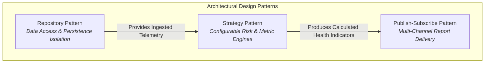
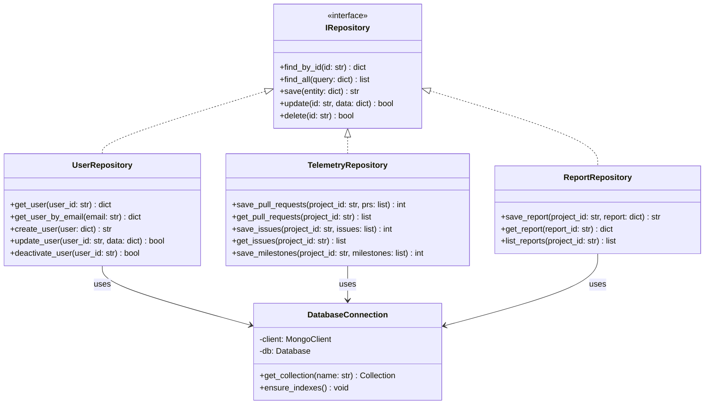
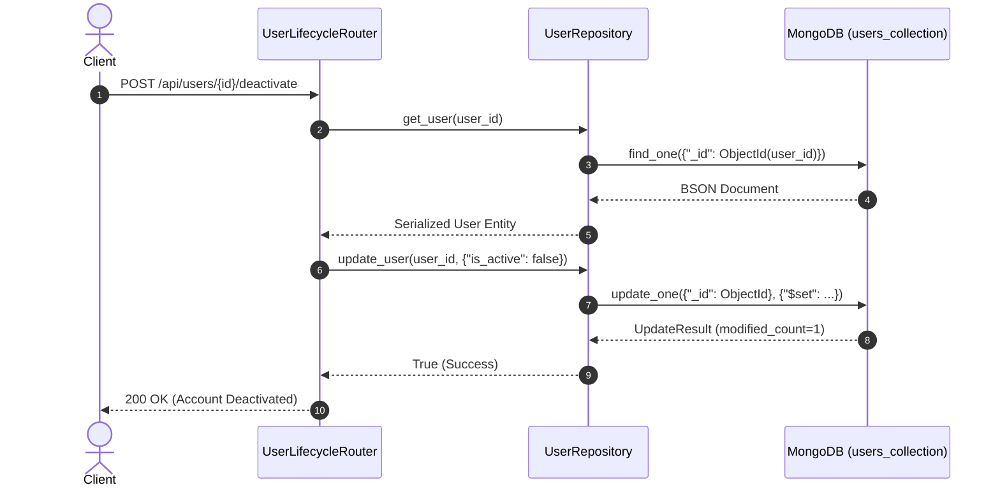
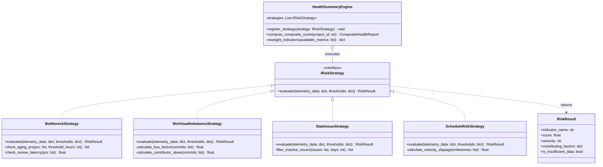
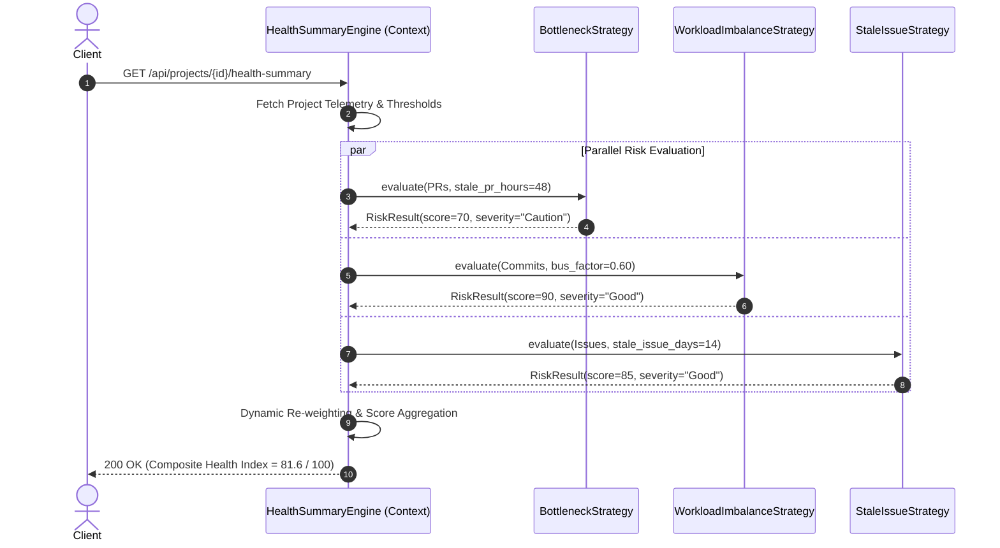
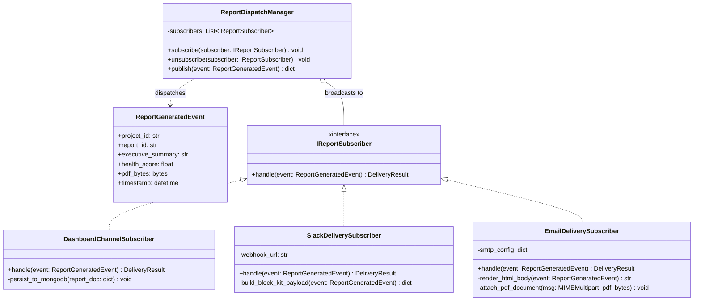
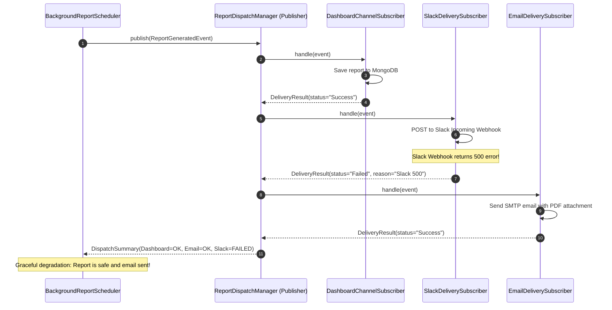

# Object Design Document: Design Patterns & Structural Architecture

> **Course:** IT314: Software Engineering (Autumn 2026–27)  
> **Project:** AI Software Project Health & Risk Analyzer  
> **Document Type:** Object Design Specification  
> **Focus:** Architectural Design Patterns (Repository, Strategy, Publish-Subscribe)  

---

## 1. Executive Summary & Design Objectives

Object Design bridges high-level requirements (elicited in Epics E1–E5) and concrete class implementations. The system architecture addresses complex challenges:
- Ingesting heterogeneous telemetry (commits, PRs, issues, milestones) from external APIs.
- Evaluating deterministic risks across configurable project thresholds.
- Enforcing strict security boundaries for prompt injection and RBAC.
- Synthesizing grounded AI status reports and delivering them across multiple channels.

To maintain **high cohesion, low coupling, and extensible structure**, the system incorporates three foundational object-oriented design patterns:

---

## 2. Pattern 1: Repository Pattern (Data Access Layer)

### 2.1. Intent & Problem Statement
Direct interaction between API route handlers and database queries creates tight coupling, leaks persistence technology details into the domain, and severely degrades unit testability. The **Repository Pattern** abstracts MongoDB queries behind a cohesive collection-level interface, managing database interactions, object serialization, and error wrapping.

### 2.2. Structure & UML Class Diagram

### 2.3. Sequence Flow: Repository Data Access

### 2.4. Implementation Highlights in Codebase
In `Backend/persistence.py`, `Backend/persistence_telemetry.py`, and `Backend/persistence_reports.py`:
- **Exception Encapsulation**: Low-level `PyMongoError`, `ServerSelectionTimeoutError`, and `ConnectionFailure` are caught and translated into domain-level `DatabaseError` exceptions, preventing database connection leaks into the presentation layer.
- **Compound Unique Indexing**: The repositories configure unique compound indexes (`projectId` + `githubId`) to enforce idempotency when recurring webhook syncs occur.
- **DTO Serialization**: MongoDB `ObjectId` types and datetimes are normalized into JSON-compliant dictionaries and Pydantic schemas.

---

## 3. Pattern 2: Strategy Pattern (Configurable Risk & Metric Engines)

### 3.1. Intent & Problem Statement
Project health evaluation requires analyzing disparate metrics with differing thresholds (e.g. PR latency, issue age, commit concentration, schedule slippage). Hardcoding these calculations into a monolithic analyzer violates the **Open/Closed Principle (OCP)**. 

The **Strategy Pattern** encapsulates each risk detection algorithm into an independent strategy object conforming to a common contract. The `HealthSummaryEngine` acts as the context, dynamically applying active strategies and re-weighting indicators when telemetry sources are missing.

### 3.2. Structure & UML Class Diagram

### 3.3. Sequence Flow: Dynamic Risk Evaluation

### 3.4. Concrete Benefits in the Analyzer
1. **Dynamic Re-weighting for Insufficient Data**: If milestone data is absent, `ScheduleRiskStrategy` returns `is_insufficient_data=True`. Rather than penalizing the score to zero, `HealthSummaryEngine` dynamically reallocates weights across the remaining three active strategies.
2. **Threshold Pluggability**: Strategy thresholds (`stale_pr_hours`, `stale_issue_days`, `bus_factor_threshold`) are injected per project, allowing teams to adjust strictness without altering evaluation logic.

---

## 4. Pattern 3: Publish-Subscribe / Observer Pattern (Multi-Channel Delivery)

### 4.1. Intent & Problem Statement
When a project status report is compiled (by the LLM service or on a scheduled timer), stakeholders require delivery to different channels:
1. In-App Dashboard (MongoDB persistent storage)
2. Slack (Block Kit webhook formatted alert)
3. Email (SMTP dispatch with generated PDF report attached)

Coupling the report synthesizer directly to Slack and SMTP APIs violates Single Responsibility and risks cascading failures (e.g. an expired Slack webhook causing the entire report generation job to fail). The **Publish-Subscribe (Observer) Pattern** decouples event generation from delivery channels.

### 4.2. Structure & UML Class Diagram

### 4.3. Sequence Flow: Multi-Channel Broadcast with Fault Isolation

### 4.4. Concrete Benefits in the System
- **Fault Tolerance & Graceful Degradation**: As shown in the sequence diagram, an external network failure on Slack does not impede in-app dashboard persistence or email delivery.
- **Channel Extensibility**: Adding future integration adapters (e.g. Microsoft Teams, Discord, Jira) requires creating a new subscriber implementing `IReportSubscriber` without modifying existing report logic.

---

## 5. Architectural Quality Attributes & SOLID Principles Mapping

The object design adheres strictly to the SOLID engineering guidelines:

| Principle | Implementation in Codebase | Concrete Example |
|---|---|---|
| **Single Responsibility (SRP)** | Modular separation between routers, risk engines, persistence, and delivery. | `Backend/ai/prompt_guard.py` only handles prompt sanitization and response parsing; it does not connect to the database or format HTTP responses. |
| **Open/Closed (OCP)** | New analysis metrics and delivery channels extend base contracts without modifying caller code. | `IRiskStrategy` allows adding sprint burndown or PR review queue strategies without editing `HealthSummaryEngine`. |
| **Liskov Substitution (LSP)** | All delivery channels conform to `IReportSubscriber` and can be substituted transparently. | `SlackDeliverySubscriber` and `EmailDeliverySubscriber` return consistent `DeliveryResult` structures. |
| **Interface Segregation (ISP)** | Granular, focused schemas and contracts. | Pydantic models define discrete contracts: `ExplanationSchema`, `RecommendationSchema`, `ReportResponseSchema` using `extra="forbid"`. |
| **Dependency Inversion (DIP)** | High-level business modules depend on abstractions, injected via FastAPI `Depends`. | Routers depend on `get_current_user` and DAO functions, mocked in tests with zero database requirements. |

---

## 6. Summary

By systematically applying the **Repository**, **Strategy**, and **Publish-Subscribe** patterns, the AI Software Project Health & Risk Analyzer achieves clean modularity, resilient error isolation, high code coverage (>90% unit test success), and compliance with the IT314 course evaluation criteria.
