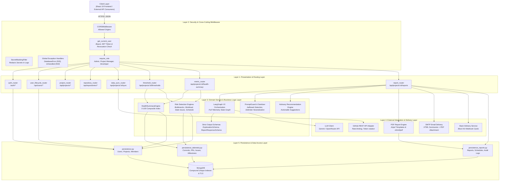
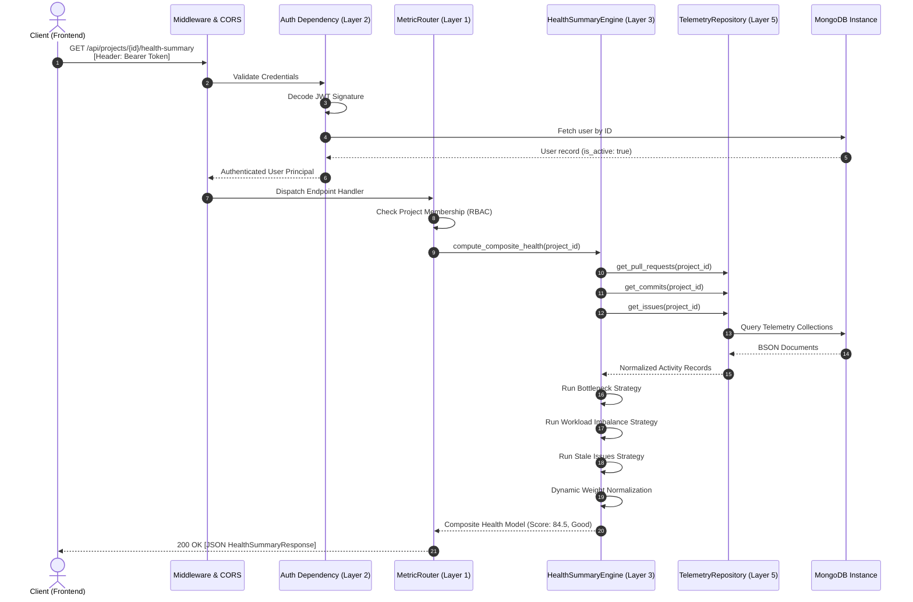

# System Design Document: Multi-Layer FastAPI Architecture

> **Course:** IT314: Software Engineering (Autumn 2026–27)  
> **Project:** AI Software Project Health & Risk Analyzer  
> **Document Type:** System Architecture & Technical Design Specification  
> **Scope:** Multi-Layer Backend Design, Security Boundary, and Cross-Sprint Integration (Sprints 1–4)  

---

## 1. Architectural Philosophy & Overview

The **AI Software Project Health & Risk Analyzer** backend is constructed using a **strict 5-layer clean architectural model** implemented in **FastAPI (Python 3.15)** and backed by **MongoDB**.

The architectural philosophy adheres to five core tenets:
1. **Separation of Concerns (SoC)**: Strict segregation between presentation, authentication, domain analytics, external integrations, and database persistence.
2. **Deterministic Metrics First**: Transparent mathematical calculations (PR age, commit concentration, issue inactivity) are computed deterministically before AI synthesis.
3. **No Hallucinated Scores / Data**: If telemetry is missing, the system dynamically re-weights or explicitly discloses "Insufficient Data" rather than manufacturing synthetic figures.
4. **Advisory AI Governance**: GenAI assists with plain-language explanations and non-prescriptive recommendations; all decisions remain with engineering leads.
5. **Defense-in-Depth Security**: Prompt injection guards, token masking in logs, role-based access control, and immediate session invalidation for deactivated users.

---

## 2. Multi-Layer Architecture Diagram

---

## 3. Layer-by-Layer Architectural Specification

### 3.1. Layer 1: Presentation & Routing Layer
- **Responsibility**: Expose RESTful HTTP contracts, validate request bodies, deserialize path/query parameters, and serialize standardized responses.
- **Components**:
  - `Backend/auth/router.py`: Handles `/auth/signup`, `/auth/login`, `/auth/logout`, `/auth/me`.
  - `Backend/auth/lifecycle.py`: Handles `/api/users/{id}/deactivate` (restricted to Admin).
  - `Backend/routers/project_router.py`: Full CRUD for projects and member role assignment.
  - `Backend/routers/repository_router.py`: Connects GitHub repositories and proxies branch queries using the server `GITHUB_TOKEN` to eliminate client-side rate limits.
  - `Backend/routers/threshold_router.py`: Configures project-specific risk boundaries (`stale_pr_hours`, `stale_issue_days`, `workload_imbalance_ratio`, `bus_factor_threshold`).
  - `Backend/routers/metric_router.py`: Endpoints for composite health, PR bottlenecks, workload distribution, and stale issue lists.
  - `Backend/routers/report_router.py`: On-demand report synthesis, PDF streaming download, and multi-channel dispatch triggers.
- **Schema Validation**: Built with Pydantic v2 models using `ConfigDict(extra="forbid", str_strip_whitespace=True)`. Boundary validators reject out-of-bounds parameters before business execution, returning clean `422 Unprocessable Entity` errors.

### 3.2. Layer 2: Security & Cross-Cutting Middleware Layer
- **Responsibility**: Authenticate requests, enforce access boundaries, sanitize logs, and handle infrastructure failures gracefully.
- **Components**:
  1. **Authentication Dependency (`get_current_user`)**:
     - Extracts and verifies Bearer JWT tokens using cryptographic SHA-256 signatures.
     - Resolves user document from database.
     - **Session Revocation**: Immediately checks `if user.get("is_active") is False: raise 401 Unauthorized`, revoking access across all existing JWT sessions upon administrative deactivation.
  2. **Role-Based Authorization (`require_role`)**:
     - Enforces permissions using system roles (`admin`, `project_manager`, `developer`).
     - Rejects unauthorized callers with `403 Forbidden`.
  3. **Secret-Masking Log Filter (`_SecretMaskingFilter`)**:
     - Intercepts Python logging streams. Regex matches and replaces any sensitive token, secret, password, or MongoDB URI strings with `<REDACTED>` before emission to stdout or log files.
  4. **Global Exception Handlers**:
     - Translates all internal `DatabaseError` exceptions into `503 Service Unavailable`.
     - Catches unhandled exceptions, logs the full trace server-side, and returns an opaque `500 Internal Server Error` to prevent leaking internals to attackers.
  5. **CORS Middleware**:
     - Configurable origins via environment variables, defaulting to authorized frontend ports (`3000`, `5000`, `5173`).

### 3.3. Layer 3: Domain Service & Business Logic Layer
- **Responsibility**: Execute core deterministic algorithms, enforce AI guardrails, and coordinate synthesis workflows.
- **Components**:
  1. **Composite Health Score Engine (`Backend/analysis/health_summary.py`)**:
     - Aggregates PR bottlenecks, workload skew, stale issues, and schedule velocity into a 0–100 index:
       - Score $\ge 75$: **Good** (Green)
       - $50 \le$ Score $< 75$: **Caution** (Yellow)
       - Score $< 50$: **At Risk** (Red)
     - **Dynamic Re-Weighting**: Automatically reallocates weights among available sources when a data source is empty, avoiding artificial score penalties.
  2. **Prompt Injection Guard (`Backend/ai/prompt_guard.py`)**:
     - Sanitizes external GitHub text (commit messages, PR titles, issue descriptions) to prevent prompt hijacking.
     - Strips Unicode Bidi overrides (`\u202E`), zero-width evasion characters, and ASCII control characters.
     - Neutralizes LLM delimiter tokens (`<|im_start|>`, `[INST]`, `<<SYS>>`, `<system>`).
     - Detects jailbreaks (DAN mode, roleplay escapes, system prompt extraction).
     - Encapsulates untrusted external text in `<untrusted_external_content>` tags.
     - Strictly validates LLM JSON responses with Pydantic schemas, rejecting hallucinated extra keys.
  3. **Advisory Recommendations Engine (`Backend/ai/recommendation_service.py`)**:
     - Synthesizes targeted suggestions for active risk flags. Enforces `is_advisory = True` and explicit non-prescriptive governance disclaimers.
  4. **LangGraph V2 Pipeline (`Backend/externalservies/LangGraph/`)**:
     - Orchestrates telemetry normalization, metric analysis, grounded executive summary generation, and structured report compilation into a cohesive state machine.

### 3.4. Layer 4: External Integration & Delivery Layer
- **Responsibility**: Interface with third-party cloud services, APIs, and export renderers.
- **Components**:
  1. **GitHub REST API Client**: Ingests commits, PR reviews, issues, and milestones using authenticated requests under the server `GITHUB_TOKEN` (5,000 requests/hour quota).
  2. **LLM Provider Gateway**: Connects via OpenRouter / Google Gemini API using structured system prompts and deterministic temperature settings.
  3. **PDF Generation Service**: Renders HTML status reports with health score badges and action checklists into downloadable PDF binaries using Jinja2 and `xhtml2pdf`.
  4. **Email Delivery Service**: Dispatches automated multipart emails over SMTP with HTML body and attached PDF report.
  5. **Slack Delivery Service**: Translates status reports into interactive Slack Block Kit cards and posts to configured project webhooks.

### 3.5. Layer 5: Persistence & Data Access Layer
- **Responsibility**: Abstract physical storage, maintain database connections, and enforce storage integrity.
- **Components**:
  - `Backend/persistence.py`: Manages `users` and `projects` collections.
  - `Backend/persistence_telemetry.py`: Manages `commits`, `pull_requests`, `issues`, and `milestones` collections.
  - `Backend/persistence_reports.py`: Manages `reports`, `report_schedules`, and `audit_logs` collections.
  - **Database Connection Management**: Handles MongoClient lifecycle with Atlas SRV TLS, timeout limits (`serverSelectionTimeoutMS=10000`), and connection pooling.
  - **Compound Unique Indexes**:
    - `pull_requests`: `{ projectId: 1, number: 1 }`
    - `issues`: `{ projectId: 1, number: 1 }`
    - `commits`: `{ projectId: 1, sha: 1 }`
    - `milestones`: `{ projectId: 1, milestoneId: 1 }`
    - Guarantees data idempotency during repeated synchronizations.

---

## 4. End-to-End Request-Response Lifecycle

The sequence diagram below illustrates the complete traversal through all five architectural layers for a protected analytical request:

---

## 5. Non-Functional Quality Attribute Verification

| Category | Requirement | Architectural Enforcement |
|---|---|---|
| **Performance (NFR-02)** | API responses $<3$s, report synthesis $<60$s. | Database indexed queries, asynchronous FastAPI worker pool, lightweight Jinja2 PDF generation. |
| **Error Handling (NFR-03)** | External failures must not fabricate data or crash server. | Graceful degradation across delivery channels; explicit "Insufficient Data" indicators; global 503/500 handlers. |
| **API Efficiency (NFR-04)** | Minimize external requests, respect rate limits. | Server-side `GITHUB_TOKEN` proxying (5,000 req/hr), client branch caching, compound unique DB indexing. |
| **Security & Privacy (NFR-06)** | Secrets protected at rest, never logged. | Environment-variable injection, secret-masking log filter, bcrypt password hashing, prompt injection guardrails. |
| **Fairness & Governance (NFR-09)** | Activity not treated as personal performance. | Advisory disclaimers on all recommendations; activity treated explicitly as workflow proxies rather than individual productivity. |
| **Auditability (NFR-10)** | Record key administrative and security events. | Comprehensive audit logging for project updates, user deactivations, threshold adjustments, and report dispatches. |

---

## 6. Sprint Integration Summary

The architecture represents the unified realization of all four project sprints:
- **Sprint 1 (Foundation)**: Authentication, RBAC, project management, and base repository layer.
- **Sprint 2 (Telemetry & Risk Engines)**: PR/Issue/Milestone ingestion, threshold management, bottleneck and workload strategies, composite health index.
- **Sprint 3 (AI Synthesis & Multi-Channel Delivery)**: Prompt injection protection, strict Pydantic schemas, LangGraph v2 workflow, PDF generation, Email SMTP, and Slack Block Kit integration.
- **Sprint 4 (Governance & Lifecycle)**: Account deactivation API, immediate JWT session invalidation, OpenAPI documentation export, and object design artifacts.
