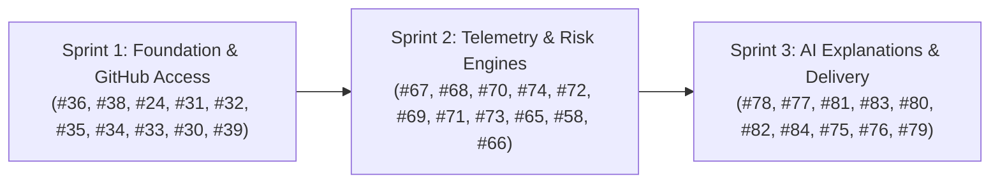

# AI Software Project Health & Risk Analyzer — Issue Roadmap

- **GitHub Repository:** [OpenTirZ/Ai-Software-Project-Health-and-Risk-Analyzer](https://github.com/OpenTirZ/Ai-Software-Project-Health-and-Risk-Analyzer)
- **GitHub Issues Tracker:** [View All Issues](https://github.com/OpenTirZ/Ai-Software-Project-Health-and-Risk-Analyzer/issues)

---

## Folder Structure

```text
sprint-issue-roadmap/
├── README.md              # Roadmap overview and cross-sprint workflow
├── sprint-1/
│   └── README.md          # Sprint 1: Foundation, Auth, Projects, Commits, Contributors, UI
├── sprint-2/
│   └── README.md          # Sprint 2: PRs, Issues, Milestones, Risk Engines, Health Score, Dashboard
└── sprint-3/
    └── README.md          # Sprint 3: AI Safety, Reports, PDF, Email, Slack, Scheduler
```

---

## High-Level Sprint Flow



---

## How to Follow the Roadmap

1. **Follow the Sequence Number, Not the Issue Number:**  
   GitHub issue numbers (e.g. #30, #36) reflect when tickets were opened. The sequence number (1, 2, 3...) shows the correct technical build order.
2. **Check Blockers First:**  
   Ensure prerequisite issues are completed before starting dependent tasks.
3. **Use Parallel Groups:**  
   Different team members can safely work on independent tasks at the same time.
4. **Detailed Sprint Roadmaps:**
   - [Sprint 1 Roadmap](sprint-1/README.md)
   - [Sprint 2 Roadmap](sprint-2/README.md)
   - [Sprint 3 Roadmap](sprint-3/README.md)


---

> *Verified against live GitHub Issues on October 31, 2026.*
