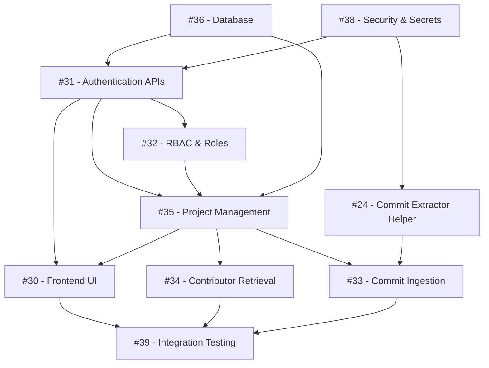

# Sprint 1 Roadmap: Foundational System & GitHub Connection

### Sprint Goal
Set up the MongoDB database and safe secret handling, build authentication and project management, and ingest initial GitHub commit history and contributors with a working frontend UI.

---

### Issue Execution Order

**1. [Issue #36 — Design MongoDB Schema and Persistence Layer](https://github.com/OpenTirZ/Ai-Software-Project-Health-and-Risk-Analyzer/issues/36)**  
- **Why first:** Other components need a stable database structure to store users, projects, commits, and contributors.  
- **Status:** Closed (Implemented in `Backend/database.py` and `Backend/persistence.py`).

**2. [Issue #38 — Implement Secret Management and External-Service Error Handling](https://github.com/OpenTirZ/Ai-Software-Project-Health-and-Risk-Analyzer/issues/38)**  
- **Why next:** Loads environment secrets safely (`GITHUB_TOKEN`, `MONGO_URI`) and defines standard error handling for external service failures.  
- **Status:** Closed (Implemented).

**3. [Issue #24 — Implement GitHub Commit History Extraction](https://github.com/OpenTirZ/Ai-Software-Project-Health-and-Risk-Analyzer/issues/24)**  
- **Why next:** Reusable REST API helper to fetch commits from GitHub. Required by the commit ingestion service.  
- **Status:** Closed (Implemented in `Backend/externalservies/github_commits.py`).

**4. [Issue #31 — Implement Authentication APIs and Session Handling](https://github.com/OpenTirZ/Ai-Software-Project-Health-and-Risk-Analyzer/issues/31)**  
- **Why next:** User signup, login, password hashing, and JWT tokens. Required before applying role checks and project ownership.  
- **Status:** Closed (Merged on `origin/main`).

**5. [Issue #32 — Implement RBAC and Authorization Checks](https://github.com/OpenTirZ/Ai-Software-Project-Health-and-Risk-Analyzer/issues/32)**  
- **Why next:** Uses authentication tokens to enforce role permissions (`ADMIN`, `PROJECT_MANAGER`, `DEVELOPER`) on protected endpoints.  
- **Status:** Closed (Merged on `origin/main`).

**6. [Issue #35 — Implement Project Management and Repository Association](https://github.com/OpenTirZ/Ai-Software-Project-Health-and-Risk-Analyzer/issues/35)**  
- **Why next:** Projects are the parent container for all repository data. Connects a GitHub repository URL to a project.  
- **Status:** Closed (Merged on `origin/main`).

**7. [Issue #34 — Implement Contributor Retrieval and Project Mapping](https://github.com/OpenTirZ/Ai-Software-Project-Health-and-Risk-Analyzer/issues/34)**  
- **Why next:** Ingests contributors from the repository and maps them to the project in MongoDB without duplicate records.  
- **Status:** Closed (Verified complete with 47 passing tests).

**8. [Issue #33 — Implement Initial Commit Ingestion and Processing](https://github.com/OpenTirZ/Ai-Software-Project-Health-and-Risk-Analyzer/issues/33)**  
- **Why next:** Ingests commit history using helper #24 and maps commits to the project in MongoDB. Can be built in parallel with #34.  
- **Status:** Closed (Merged on `origin/main`).

**9. [Issue #30 — Build Authentication, Project Creation and Repository Connection UI](https://github.com/OpenTirZ/Ai-Software-Project-Health-and-Risk-Analyzer/issues/30)**  
- **Why next:** React interface for Login, Signup, Project Creation, and Repository Connection. Consumes backend APIs from #31 and #35.  
- **Status:** **Open** (Needs frontend implementation).

**10. [Issue #39 — Perform End-to-End Integration Testing and Document Sprint 1](https://github.com/OpenTirZ/Ai-Software-Project-Health-and-Risk-Analyzer/issues/39)**  
- **Why last:** Validates the entire happy path across frontend and backend, verifies error handling, and prepares the Sprint 1 demo.  
- **Status:** **Open** (Integration verification gate).

---

### Dependency Diagram

---

### Parallel Work

- **Foundation:** [#36](https://github.com/OpenTirZ/Ai-Software-Project-Health-and-Risk-Analyzer/issues/36) (Database) and [#38](https://github.com/OpenTirZ/Ai-Software-Project-Health-and-Risk-Analyzer/issues/38) (Secrets) can be configured together.
- **Service Scaffolding:** [#24](https://github.com/OpenTirZ/Ai-Software-Project-Health-and-Risk-Analyzer/issues/24) (Commit helper) can be written while [#31](https://github.com/OpenTirZ/Ai-Software-Project-Health-and-Risk-Analyzer/issues/31) (Auth) is being built.
- **Data Ingestion:** [#34](https://github.com/OpenTirZ/Ai-Software-Project-Health-and-Risk-Analyzer/issues/34) (Contributors) and [#33](https://github.com/OpenTirZ/Ai-Software-Project-Health-and-Risk-Analyzer/issues/33) (Commits) can be developed at the same time once [#35](https://github.com/OpenTirZ/Ai-Software-Project-Health-and-Risk-Analyzer/issues/35) is ready.
- **Frontend Scaffolding:** [#30](https://github.com/OpenTirZ/Ai-Software-Project-Health-and-Risk-Analyzer/issues/30) can be developed using mock API responses while backend routes are stabilized.

---

### Blockers

- **#36 (Database)** blocks all backend persistence.
- **#31 (Auth) & #35 (Projects)** block frontend UI integration (#30).
- **#35 (Projects)** blocks commit (#33) and contributor (#34) ingestion.
- **#30 (Frontend) & branch integration** block complete end-to-end testing (#39).

---

### Sprint Completion Checklist

- [x] MongoDB database connection active with compound unique indexes.
- [x] Environment secrets loaded safely; GitHub errors return controlled responses.
- [x] User registration, login, and RBAC operational.
- [x] Project creation and repository URL linking operational.
- [x] Contributor and commit ingestion working with zero duplicate records (47 unit tests pass).
- [ ] Working React UI for Login, Signup, Project Creation, and Repo Connection ([#30](https://github.com/OpenTirZ/Ai-Software-Project-Health-and-Risk-Analyzer/issues/30)).
- [ ] Automated end-to-end test passes from login to repository data storage ([#39](https://github.com/OpenTirZ/Ai-Software-Project-Health-and-Risk-Analyzer/issues/39)).

---

> *Verified against live GitHub Issues and source code on October 31, 2026.*
