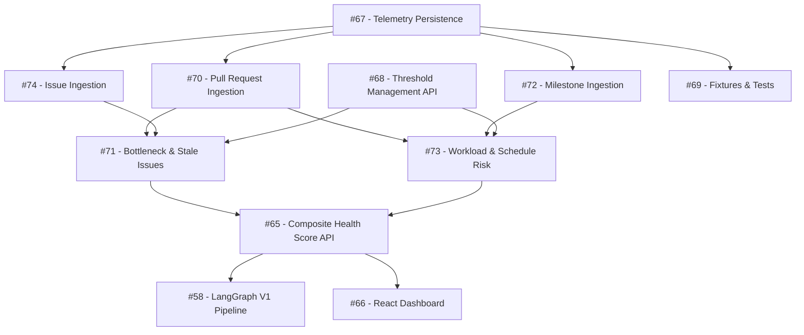

# Sprint 2 Roadmap: Telemetry Ingestion, Risk Engines & Dashboard

### Sprint Goal
Ingest pull requests, issues, and milestones; set configurable risk thresholds; detect bottlenecks, stale issues, and workload imbalances; calculate a 0–100 composite health score; and display the results on a React dashboard.

---

### Special Note: Overlap Between Issues #58 and #67

- **[Issue #58](https://github.com/OpenTirZ/Ai-Software-Project-Health-and-Risk-Analyzer/issues/58):** High-level architectural specification for the LangGraph workflow.
- **[Issue #67](https://github.com/OpenTirZ/Ai-Software-Project-Health-and-Risk-Analyzer/issues/67):** Concrete task card containing two deliverables:
  1. LangGraph V1 pipeline (`pipeline.py`, already merged on `origin/main` in PR #64).
  2. Telemetry persistence DAO (`persistence_telemetry.py`) and MongoDB unique indexes for PRs, issues, and milestones (pending implementation).
- **Action:** Keep both issues open on GitHub. Tirth and Varshil must implement the missing telemetry persistence functions from #67 to unblock ingestion tasks (#70, #74, #72).

---

### Issue Execution Order

**1. [Issue #67 — TASK-SP2-03 (Telemetry Persistence & Indexing)](https://github.com/OpenTirZ/Ai-Software-Project-Health-and-Risk-Analyzer/issues/67)**  
- **Why first:** Creates `Backend/persistence_telemetry.py` and MongoDB compound unique indexes. Ingestion tasks cannot store data without this.  
- **Status:** **Open** (Pipeline merged in PR #64; persistence DAO pending).

**2. [Issue #68 — TASK-SP2-04 (Threshold Management API)](https://github.com/OpenTirZ/Ai-Software-Project-Health-and-Risk-Analyzer/issues/68)**  
- **Why next:** Provides APIs to set and review project risk limits (e.g. stale PR > 48h, stale issue > 14d, bus factor > 60%). Can be built in parallel with #67.  
- **Status:** **Open**.

**3. [Issue #70 — TASK-SP2-06 (Pull Request Ingestion)](https://github.com/OpenTirZ/Ai-Software-Project-Health-and-Risk-Analyzer/issues/70)**  
- **Why next:** Ingests open/closed/merged PRs, reviewers, and open durations into MongoDB via #67.  
- **Status:** **Open**.

**4. [Issue #74 — TASK-SP2-10 (GitHub Issue Ingestion)](https://github.com/OpenTirZ/Ai-Software-Project-Health-and-Risk-Analyzer/issues/74)**  
- **Why next:** Ingests repository issues, filters out PRs, and records inactivity timestamps into MongoDB via #67.  
- **Status:** **Open**.

**5. [Issue #72 — TASK-SP2-08 (GitHub Milestone Ingestion)](https://github.com/OpenTirZ/Ai-Software-Project-Health-and-Risk-Analyzer/issues/72)**  
- **Why next:** Ingests milestones to track sprint task completion percentages.  
- **Status:** **Open**.

**6. [Issue #69 — TASK-SP2-05 (Telemetry Fixtures & Hardening Tests)](https://github.com/OpenTirZ/Ai-Software-Project-Health-and-Risk-Analyzer/issues/69)**  
- **Why next:** Builds mock JSON payloads and tests rate limits, 0-data safety, and token masking.  
- **Status:** **Open**.

**7. [Issue #71 — TASK-SP2-07 (Bottleneck & Stale-Issue Detection Engine)](https://github.com/OpenTirZ/Ai-Software-Project-Health-and-Risk-Analyzer/issues/71)**  
- **Why next:** Evaluates aging PRs (> 48h), review queue bottlenecks, and inactive issues (> 14d) against thresholds from #68.  
- **Status:** **Open**.

**8. [Issue #73 — TASK-SP2-09 (Workload & Schedule-Risk Engines)](https://github.com/OpenTirZ/Ai-Software-Project-Health-and-Risk-Analyzer/issues/73)**  
- **Why next:** Calculates contributor activity distribution (bus factor > 60%) and milestone schedule slippage.  
- **Status:** **Open**.

**9. [Issue #65 — TASK-SP2-01 (Composite Health Score & Summary API)](https://github.com/OpenTirZ/Ai-Software-Project-Health-and-Risk-Analyzer/issues/65)**  
- **Why next:** Combines bottleneck, workload, stale issue, and schedule indicators into a single 0–100 health index (`/api/projects/{id}/health-summary`).  
- **Status:** **Open**.

**10. [Issue #58 — LangGraph Project-Intelligence Workflow V1](https://github.com/OpenTirZ/Ai-Software-Project-Health-and-Risk-Analyzer/issues/58)**  
- **Why next:** Integrates LangGraph V1 pipeline with live MongoDB telemetry and metrics-only fallback.  
- **Status:** **Open** (Pipeline code merged on `origin/main`).

**11. [Issue #66 — TASK-SP2-02 (React Health Dashboard)](https://github.com/OpenTirZ/Ai-Software-Project-Health-and-Risk-Analyzer/issues/66)**  
- **Why last:** Visualizes health score gauges, bottleneck radar, workload charts, and stale issue tables by consuming #65.  
- **Status:** **Open**.

---

### Dependency Diagram

---

### Parallel Work

- **Telemetry Ingestion:** [#70](https://github.com/OpenTirZ/Ai-Software-Project-Health-and-Risk-Analyzer/issues/70) (PRs), [#74](https://github.com/OpenTirZ/Ai-Software-Project-Health-and-Risk-Analyzer/issues/74) (Issues), and [#72](https://github.com/OpenTirZ/Ai-Software-Project-Health-and-Risk-Analyzer/issues/72) (Milestones) can be implemented simultaneously once [#67](https://github.com/OpenTirZ/Ai-Software-Project-Health-and-Risk-Analyzer/issues/67) defines the persistence DAO.
- **Thresholds & Tests:** [#68](https://github.com/OpenTirZ/Ai-Software-Project-Health-and-Risk-Analyzer/issues/68) (Thresholds) and [#69](https://github.com/OpenTirZ/Ai-Software-Project-Health-and-Risk-Analyzer/issues/69) (Fixtures) can be built in parallel with ingestion.
- **Risk Engines:** [#71](https://github.com/OpenTirZ/Ai-Software-Project-Health-and-Risk-Analyzer/issues/71) (Bottlenecks) and [#73](https://github.com/OpenTirZ/Ai-Software-Project-Health-and-Risk-Analyzer/issues/73) (Workload) can be written concurrently once telemetry data structures are frozen.
- **Dashboard UI:** [#66](https://github.com/OpenTirZ/Ai-Software-Project-Health-and-Risk-Analyzer/issues/66) components can be scaffolded using mock JSON while the backend is implemented.

---

### Blockers

- **#67 (Persistence DAO)** blocks PR (#70), Issue (#74), and Milestone (#72) ingestion.
- **#70 (PRs) & #74 (Issues)** block Bottleneck & Stale Issue analysis (#71).
- **#71 & #73 (Risk Engines)** block the Composite Health Score API (#65).
- **#65 (Health Score API)** blocks full React Dashboard integration (#66).

---

### Sprint Completion Checklist

- [ ] `Backend/persistence_telemetry.py` active with unique indexes for PRs, issues, and milestones.
- [ ] PR, Issue, and Milestone sync endpoints successfully populate MongoDB.
- [ ] Thresholds API allows reading and updating project risk limits.
- [ ] Bottleneck, stale issue, bus factor, and schedule risk engines produce traceable evidence.
- [ ] `GET /api/projects/{id}/health-summary` returns a valid 0–100 score and factor breakdown.
- [ ] LangGraph V1 pipeline runs with live data and falls back gracefully when LLM is unavailable.
- [ ] React Dashboard displays health gauges, charts, risk lists, and last-sync timestamps.

---

> *Verified against live GitHub Issues and source code on October 31, 2026.*
