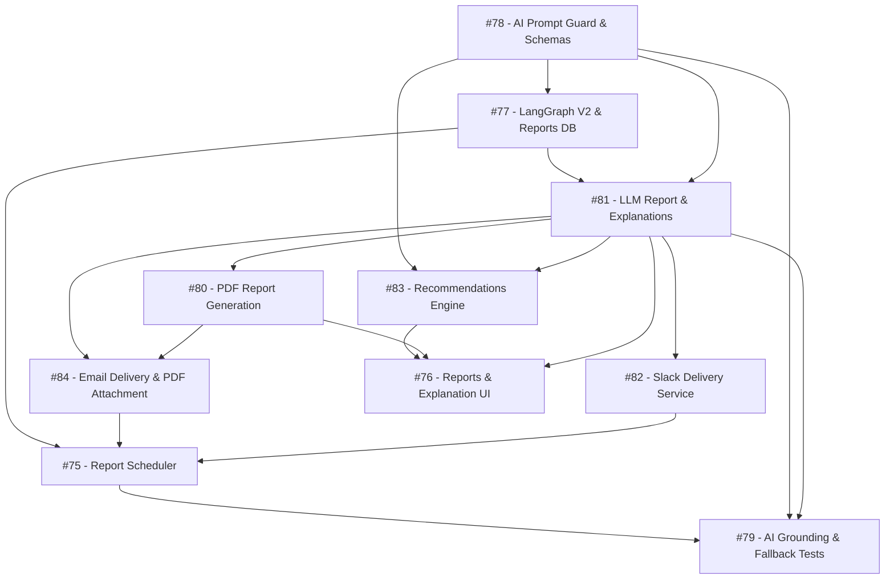

# Sprint 3 Roadmap: AI Explanations, Reporting & Multi-Channel Delivery

### Sprint Goal
Add prompt injection protection and strict schemas; expand LangGraph to full telemetry; synthesize grounded status reports and advisory recommendations; export PDFs; deliver via Email and Slack; and automate recurring schedules.

---

### Issue Execution Order

**1. [Issue #78 — TASK-SP3-04 (AI Prompt-Injection Protection & Output Schemas)](https://github.com/OpenTirZ/Ai-Software-Project-Health-and-Risk-Analyzer/issues/78)**  
- **Why first:** Sanitizes external GitHub text (`prompt_guard.py`) and defines strict Pydantic schemas. All AI modules rely on this security boundary.  
- **Status:** **Open**.

**2. [Issue #77 — TASK-SP3-03 (LangGraph V2 & Report Persistence)](https://github.com/OpenTirZ/Ai-Software-Project-Health-and-Risk-Analyzer/issues/77)**  
- **Why next:** Expands LangGraph to PRs, issues, and milestones, and creates `Backend/persistence_reports.py` to store reports and schedules in MongoDB. Feeds data into the LLM client (#81).  
- **Status:** **Open**.

**3. [Issue #81 — TASK-SP3-07 (LLM Client, Report Generation & Explanations)](https://github.com/OpenTirZ/Ai-Software-Project-Health-and-Risk-Analyzer/issues/81)**  
- **Why next:** Core AI service. Connects to Gemini/OpenRouter to synthesize grounded executive status narratives and plain-language flag explanations.  
- **Status:** **Open**.

**4. [Issue #83 — TASK-SP3-09 (Advisory Recommendations Engine)](https://github.com/OpenTirZ/Ai-Software-Project-Health-and-Risk-Analyzer/issues/83)**  
- **Why next:** Generates actionable, advisory engineering suggestions for active risk flags using #81 and #78.  
- **Status:** **Open**.

**5. [Issue #80 — TASK-SP3-06 (PDF Report Generation)](https://github.com/OpenTirZ/Ai-Software-Project-Health-and-Risk-Analyzer/issues/80)**  
- **Why next:** Formats the status report into a downloadable PDF document with health badges and action checklists.  
- **Status:** **Open**.

**6. [Issue #82 — TASK-SP3-08 (Slack Delivery Service)](https://github.com/OpenTirZ/Ai-Software-Project-Health-and-Risk-Analyzer/issues/82)**  
- **Why next:** Formats reports into Slack Block Kit cards and posts to configured Slack webhooks.  
- **Status:** **Open**.

**7. [Issue #84 — TASK-SP3-10 (Email Delivery Service)](https://github.com/OpenTirZ/Ai-Software-Project-Health-and-Risk-Analyzer/issues/84)**  
- **Why next:** Sends HTML summary emails via SMTP with Darpan's PDF from #80 attached.  
- **Status:** **Open**.

**8. [Issue #75 — TASK-SP3-01 (Report Scheduling & Delivery Orchestration)](https://github.com/OpenTirZ/Ai-Software-Project-Health-and-Risk-Analyzer/issues/75)**  
- **Why next:** Background scheduler triggering recurring report generation and dispatch to Dashboard, Email, and Slack.  
- **Status:** **Open**.

**9. [Issue #76 — TASK-SP3-02 (Report Generation & Explanation UI)](https://github.com/OpenTirZ/Ai-Software-Project-Health-and-Risk-Analyzer/issues/76)**  
- **Why next:** React UI pages for on-demand report generation, AI explanation popovers, and PDF download.  
- **Status:** **Open**.

**10. [Issue #79 — TASK-SP3-05 (AI Grounding, Fallback & Security Tests)](https://github.com/OpenTirZ/Ai-Software-Project-Health-and-Risk-Analyzer/issues/79)**  
- **Why last:** Verifies that AI outputs reference only computed metrics, handle API downtime gracefully, and never leak credentials.  
- **Status:** **Open**.

---

### Dependency Diagram

---

### Parallel Work

- **Export & Delivery:** [#80](https://github.com/OpenTirZ/Ai-Software-Project-Health-and-Risk-Analyzer/issues/80) (PDF) and [#82](https://github.com/OpenTirZ/Ai-Software-Project-Health-and-Risk-Analyzer/issues/82) (Slack) can be developed simultaneously once #81 (LLM Client) defines the report schema.
- **Delivery Channels:** [#82](https://github.com/OpenTirZ/Ai-Software-Project-Health-and-Risk-Analyzer/issues/82) (Slack) and [#84](https://github.com/OpenTirZ/Ai-Software-Project-Health-and-Risk-Analyzer/issues/84) (Email) can be developed in parallel.
- **Frontend Scaffolding:** [#76](https://github.com/OpenTirZ/Ai-Software-Project-Health-and-Risk-Analyzer/issues/76) UI components can be developed with mock JSON while backend AI services are wired up.

---

### Blockers

- **#78 (AI Guard & Schemas)** blocks LangGraph V2 (#77), LLM client (#81), and Recommendations (#83).
- **#77 (LangGraph V2)** blocks LLM report generation (#81).
- **#81 (Report Service)** blocks PDF generation (#80), Slack delivery (#82), and Email delivery (#84).
- **#81, #82, #84** block automated scheduling (#75).

---

### Sprint Completion Checklist

- [ ] Prompt injection protection sanitizes all external GitHub text.
- [ ] LLM responses parse cleanly into Pydantic models with zero unhandled JSON formatting errors.
- [ ] Generated reports and flag explanations reference only computed metrics.
- [ ] Advisory recommendations generate with clear non-prescriptive disclaimers.
- [ ] `GET /api/projects/{id}/reports/{reportId}/pdf` downloads a valid PDF.
- [ ] Automated email and Slack notifications deliver formatted summaries.
- [ ] Background scheduler reliably executes recurring report generation.
- [ ] Automated grounding tests (`test_ai_grounding.py` and `test_ai_fallback.py`) pass with zero hallucinated figures.

---

> *Verified against live GitHub Issues and source code on October 31, 2026.*
