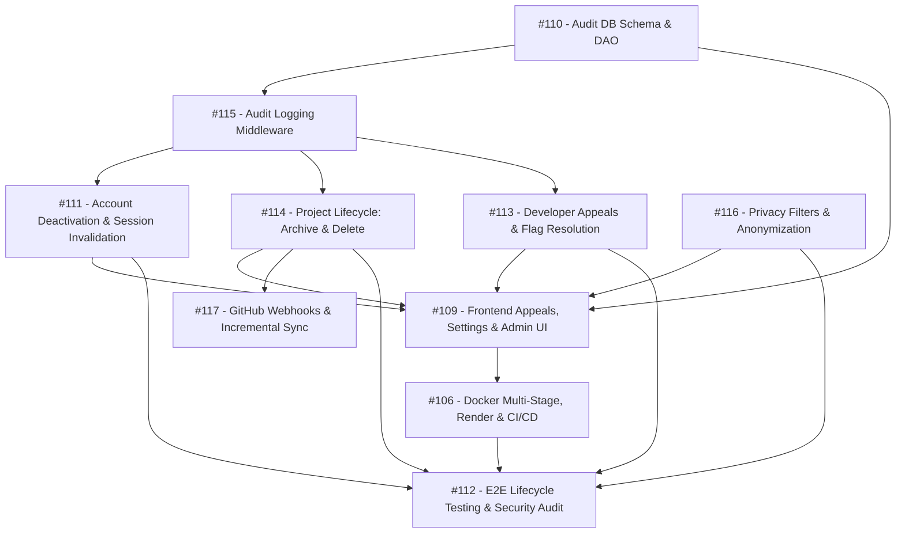

# Sprint 4 Roadmap: Feedback, Administration, Hardening & Release

### Sprint Goal
Complete user feedback and lifecycle controls (Developer Appeals, Project Archive/Delete, Account Deactivation), implement enterprise audit logging and contributor privacy filters, enable real-time GitHub webhook sync, harden multi-stage Docker deployment with GitHub Actions CI, and execute end-to-end integration and security penetration testing.

---

### Issue Execution Order

**1. [Issue #110 — TASK-SP4-03 (Audit Logs Schema, Fast Persistence & TTL Index)](https://github.com/OpenTirZ/Ai-Software-Project-Health-and-Risk-Analyzer/issues/110)**  
- **Why first:** Models the `audit_logs` collection in MongoDB Atlas with compound index `(timestamp: -1, resourceType: 1)` and 90-day TTL index. Required as the foundational persistence layer before intercepting state-changing requests.  
- **Status:** **Closed** (Implemented in `Backend/persistence_audit.py`, `Backend/database.py`, and verified with 14 unit tests in `Backend/tests/test_persistence_audit.py`).

**2. [Issue #115 — TASK-SP4-08 (FastAPI Audit Logging Middleware)](https://github.com/OpenTirZ/Ai-Software-Project-Health-and-Risk-Analyzer/issues/115)**  
- **Why next:** Intercepts state-changing requests (`POST`, `PUT`, `PATCH`, `DELETE`) across all routers, extracts user identity, client IP, route, and status, and writes immutable audit records using #110.  
- **Status:** **Closed** (Implemented in `Backend/audit/audit_middleware.py` and merged on `origin/main`).

**3. [Issue #111 — TASK-SP4-04 (Account Deactivation & Session Invalidation)](https://github.com/OpenTirZ/Ai-Software-Project-Health-and-Risk-Analyzer/issues/111)**  
- **Why next:** Provides administrator security governance (`POST /api/users/{id}/deactivate`) and hardens `get_current_user` in `Backend/auth/dependencies.py` to immediately reject deactivated users and invalidate active JWT sessions.  
- **Status:** **Closed** (Implemented in `Backend/routers/admin_router.py` with 100% test coverage).

**4. [Issue #114 — TASK-SP4-07 (Project Lifecycle Controls: Archive & Soft-Delete)](https://github.com/OpenTirZ/Ai-Software-Project-Health-and-Risk-Analyzer/issues/114)**  
- **Why next:** Implements project state transitions (`POST /api/projects/{id}/archive` and `DELETE /api/projects/{id}`) with strict ownership checks, cascading read-only status and disabling telemetry sync on archived projects.  
- **Status:** **Closed** (Implemented in `Backend/routers/project_router.py`).

**5. [Issue #113 — TASK-SP4-06 (Developer Appeals API & Flag Resolution Flow)](https://github.com/OpenTirZ/Ai-Software-Project-Health-and-Risk-Analyzer/issues/113)**  
- **Why next:** Core stakeholder feedback loop. Enables developers to dispute automated risk flags (`POST /api/projects/{id}/appeals`), query their submissions, and allows project leads to approve/reject appeals with review rationales.  
- **Status:** **Closed** (Implemented in `Backend/routers/appeal_router.py` and `Backend/persistence_appeals.py`).

**6. [Issue #116 — TASK-SP4-09 (Contributor Privacy Filters & Metric Anonymization)](https://github.com/OpenTirZ/Ai-Software-Project-Health-and-Risk-Analyzer/issues/116)**  
- **Why next:** Enforces data privacy by masking team-wide workload distribution for standard members, ensuring developers can only inspect their personal contribution metrics and appeal history.  
- **Status:** **Closed** (Implemented in `Backend/auth/privacy_filter.py`).

**7. [Issue #117 — TASK-SP4-10 (Real-Time GitHub Webhook Receiver & Incremental Sync)](https://github.com/OpenTirZ/Ai-Software-Project-Health-and-Risk-Analyzer/issues/117)**  
- **Why next:** Establishes event-driven telemetry (`POST /api/webhooks/github`) verifying HMAC-SHA256 signatures via GitHub webhook secret to incrementally ingest push commits and pull requests in real time.  
- **Status:** **Closed** (Implemented in `Backend/routers/webhook_router.py`).

**8. [Issue #109 — TASK-SP4-02 (Frontend Management Views: Appeals, Settings & Admin Audit Trail)](https://github.com/OpenTirZ/Ai-Software-Project-Health-and-Risk-Analyzer/issues/109)**  
- **Why next:** Comprehensive React UI views consuming Sprint 4 APIs: Developer Appeals Center (`Appeals.tsx`), Project Settings with double-confirmation Archive/Delete modals, and filterable Admin Audit Trail table.  
- **Status:** **Closed** (Implemented in `Frontend/src/pages/` and merged on `origin/main`).

**9. [Issue #106 — TASK-SP4-01 (Multi-Stage Docker, Cloud Deployment & CI/CD Pipeline)](https://github.com/OpenTirZ/Ai-Software-Project-Health-and-Risk-Analyzer/issues/106)**  
- **Why next:** Builds production-hardened multi-stage `Dockerfile` (<250MB), configures live cloud deployment on Render with dynamic `$PORT` binding, and establishes GitHub Actions CI running automated tests on every PR.  
- **Status:** **Closed** (Implemented in `Dockerfile`, `.github/workflows/ci.yml`, and `render.yaml`).

**10. [Issue #112 — TASK-SP4-05 (End-to-End Integration Testing & Security Penetration)](https://github.com/OpenTirZ/Ai-Software-Project-Health-and-Risk-Analyzer/issues/112)**  
- **Why last:** Validates the entire application lifecycle end-to-end (`test_e2e_lifecycle.py`), confirms 1,241+ automated tests pass with 0 failures, and verifies secret-masking and RBAC boundary penetration protections.  
- **Status:** **Closed** (Verified with 1,241 passing tests and zero security leaks).

---

### Dependency Diagram

---

### Parallel Work

- **Security & Governance:** [#111](https://github.com/OpenTirZ/Ai-Software-Project-Health-and-Risk-Analyzer/issues/111) (Account deactivation) and [#114](https://github.com/OpenTirZ/Ai-Software-Project-Health-and-Risk-Analyzer/issues/114) (Project lifecycle) can be developed independently once auth dependencies are established.
- **Feedback & Privacy:** [#113](https://github.com/OpenTirZ/Ai-Software-Project-Health-and-Risk-Analyzer/issues/113) (Appeals router) and [#116](https://github.com/OpenTirZ/Ai-Software-Project-Health-and-Risk-Analyzer/issues/116) (Privacy filters) can be built in parallel.
- **Frontend & Deployment:** [#109](https://github.com/OpenTirZ/Ai-Software-Project-Health-and-Risk-Analyzer/issues/109) (Management UI) and [#106](https://github.com/OpenTirZ/Ai-Software-Project-Health-and-Risk-Analyzer/issues/106) (Docker containerization & CI) can proceed concurrently with backend endpoint finalization.

---

### Blockers

- **#110 (Audit Schema & DAO)** blocks state-change audit middleware (#115).
- **#115 (Audit Middleware)** blocks secure administrative lifecycle routes (#111, #114).
- **#111, #113, #114** block complete management UI integration (#109).
- **#106 (CI & Deployment)** and all feature routes block final end-to-end integration and security certification (#112).

---

### Sprint Completion Checklist

- [x] Immutable `audit_logs` collection active in MongoDB Atlas with compound `(timestamp: -1, resourceType: 1)` and 90-day TTL index.
- [x] Audit middleware asynchronously intercepts and records all state-modifying requests (`POST`, `PUT`, `PATCH`, `DELETE`).
- [x] Admin account deactivation endpoint (`POST /api/users/{id}/deactivate`) instantly revokes active JWT access.
- [x] Project lifecycle states (`archived`, `deleted`) prevent unauthorized modifications and disable background polling.
- [x] Developer appeals workflow enables flag dispute submission, lead review, and resolution status tracking.
- [x] Metric privacy filters anonymize peer contributor data for standard developer roles.
- [x] GitHub webhook receiver verifies HMAC-SHA256 signatures for incremental event synchronization.
- [x] React management views (Appeals Center, Project Settings, Admin Audit Trail) fully operational.
- [x] Production multi-stage Docker container deployed to Render with dynamic `$PORT` binding and automated GitHub Actions CI.
- [x] Comprehensive test suite passing with 1,241+ automated tests and zero security leaks.

---

> *Verified against live GitHub Issues, commit history, and source code on November 25, 2026.*
